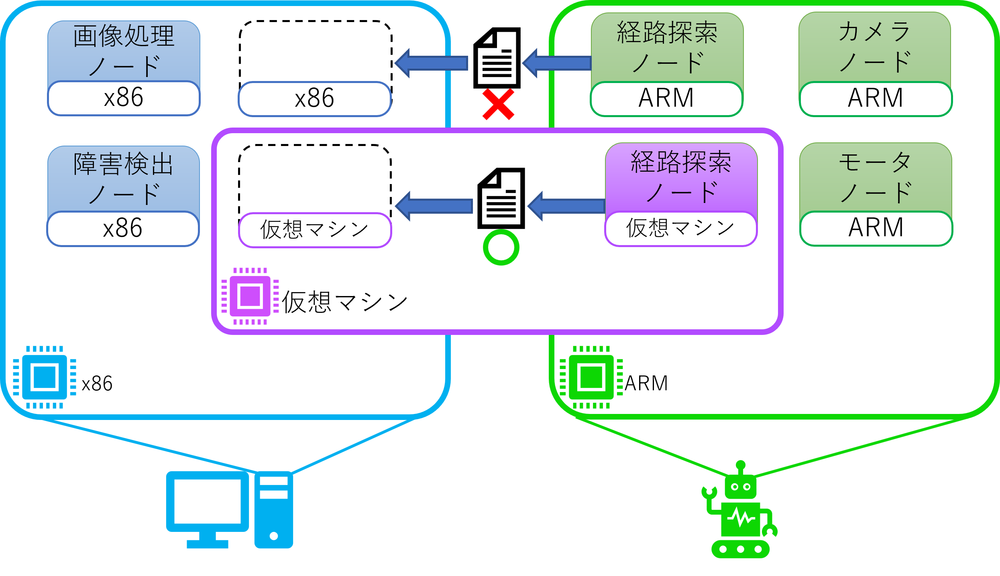
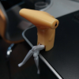
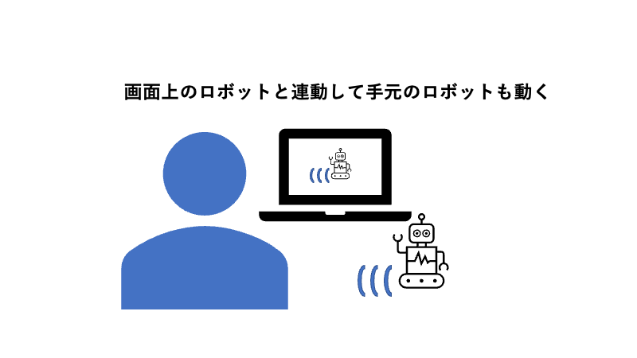

## 目次

- [オープンラボ出展概要](#オープンラボ出展概要)
- [システムソフトウェア研究](#システムソフトウェア研究)
- [研究紹介](#研究紹介)
- [研究活動](#研究活動)
- [問い合わせ先](#問い合わせ先)
- [おわりに](#おわりに)

## オープンラボ出展概要

- オープンラボ当日は，情シス・ICT コース共通 zoom ミーティング内のブレイクアウトルームにて，下記の催しを行います．
- 当日のタイムスケジュール

<table>
  <thead>
    <tr>
      <th>時間</th>
      <th width="365">オモテ</th>
      <th width="365">ウラ（低レイヤ沼）</th>
    </tr>
  </thead>
  <tbody>
    <tr>
      <td>15:30~</td>
      <td>教員による研究室紹介（松原克弥） </td>
      <td rowspan="6"></td>
    </tr>
    <tr>
      <td>15:40~</td>
      <td>LT「とにかくカワイイPCとキーボードを作った話」（林） </td>
    </tr>
    <tr>
      <td>15:50~</td>
      <td>LT「ROSで簡単にロボット動かしてみた」（瀧本） </td>
    </tr>
    <tr>
      <td>16:00~</td>
      <td>研究室所属の学部生が「みんなの疑問に答えます！」 
      ＊<a href="https://app.sli.do/event/j5rx9p9g/live/questions">Slido</a>で随時質問受け付けています</td>
    </tr>
    <tr>
      <td>16:15~</td>
      <td >LT「デジタルイラスト入門」（吉川） </td>
    </tr>
    <tr>
      <td>16:25~</td>
      <td>LT「ロボットはすぐ炎上する」（大野） </td>
    </tr>
    <tr>
      <td>16:35~</td>
      <td>教員による研究室紹介（松原克弥）</td>
      <td>学生による研究室紹介（中田，林）</td>
    </tr>
    <tr>
      <td>16:45~</td>
      <td>LT「ゼロから始まる研究生活」（熊谷）</td>
      <td rowspan="2">研究活動ライブ「論文執筆」（中田）</td>
    </tr>
    <tr>
      <td>16:55~</td>
      <td>LT「Neo4jで振り返る，よわよわ未来大生の就活」（宮越）</td>
    </tr>
    <tr>
      <td>17:05~</td>
      <td>研究室所属の院生が「みんなの疑問に答えます！」 
      ＊<a href="https://app.sli.do/event/j5rx9p9g/live/questions">Slido</a>で随時質問受け付けています</td>
      <td>研究活動ライブ「コードリーディング」（大野）</td>
    </tr>
    <tr>
      <td>17:20~</td>
      <td>修士研究紹介「動的解析にもとづくLinux Kernel Tinification手法」（雫石）</td>
      <td rowspan="2">LT「コンピュータの中心で愛を叫ぶ」（松原克弥）</td>
    </tr>
    <tr>
      <td>17:25~</td>
      <td>卒業研究紹介「ロボット制御システムにおける機能モジュールの分散配置に対する最適化機構」（大野）</td>
    </tr>
    <tr>
      <td>17:30~</td>
      <td>卒業研究紹介「ロボット制御システムにおけるOSS機能モジュール向けサンドボックスの実現」（瀧本）</td>
      <td rowspan="2">LT「OSの下でもRubyを使いたくて 〜 低レイヤーはつらいよ」（中田）</td>
    </tr>
    <tr>
      <td>17:35~</td>
      <td>卒業研究紹介「編集履歴にもとづいたイラストデータの透過的圧縮機構」（吉川）</td>
    </tr>
    <tr>
      <td>17:40~</td>
      <td>修士研究紹介「動的適応性を持つ分散システムを対象としたシステム状態可視化手法」（林）</td>
      <td rowspan="2">LT「Cでつくるゴミカスコンテナランタイム」（鈴木）</td>
    </tr>
    <tr>
      <td>17:45~</td>
      <td>卒業研究紹介「スケーラブルな分散システムの監視における依存関係の時系列変化を考慮したクエリ機能」（宮越）</td>
    </tr>
    <tr>
      <td>17:50~</td>
      <td >修士研究紹介「コンテナ型クラウドサービス基盤におけるハードウェア仮想化を併用したネットワーク機能の最適化」（中田）</td>
      <td rowspan="2">LT「Linuxカーネルビルドでも進捗が見たい！」（雫石）</td>
    </tr>
    <tr>
      <td>17:55~</td>
      <td>卒業研究紹介「VMMによる軽量かつセキュアなアドホッククラウド基盤」（熊谷）</td>
    </tr>
  </tbody>
</table>

## システムソフトウェア研究

本研究室では，システムソフトウェアの研究をとおして，社会で**飛びぬけて活躍できる**エンジニアスキルを身につけることを目指しています．

### システムソフトウェアって何？

システムソフトウェアは，PC やスマホで動く様々なアプリケーションの快適な動作や安心・安全を支える**縁の下の力持ち的**なソフトウェアです．  
代表的なものとして，OS（オペレーティングシステム）があります．  
（例：Windows，Mac，Android，Linux など）

### システムソフトウェアがないとどうなるの？

例えばインターネット... OS がないと，複雑で難解なネットワーク通信を自分で制御しなければならず，ネットサーフィンするのも一苦労です．

例えば，アプリケーションを使うとき... Word や Excel，ゲームや Web ブラウザを同時に使えなかったり，フリーズしたり快適に動作しなかったりします．さらに，システム攻撃や情報漏えいに対して無防備になります．

### システムソフトウェアを研究して，いいことあるの？

#### いいことその１：**ブラックボックスの解明**

Windows や Mac，Android など，システム内の動作や仕組みを理解できるため，システムやアプリケーションのチューンナップ，エラー発生や動作不安定の原因究明に役立ちます．

#### いいことその 2：**最新技術研究とのコラボ**

IoT（Internet of Things）やビッグデータ，クラウドコンピューティングといった最新技術に触れることができます．

#### いいことその 3：**PC やスマホの眠れる力を呼び覚ます**

PC やスマホの性能を引き出し，新たな機能を創造できます．

### こんな人にオススメ

- コンピュータやプログラムが動いている裏側を知りたい！
- 低レイヤに関する技術力を高めたい！
- 松原克弥先生が好き！

#### キーワード

- システムソフトウェア技術（仮想化，ネットワーク，システムプログラミング，並列分散処理など）
- コンピューティング技術（クラウド，IoT など）
- 圧倒的成長
- 松原克弥

## 研究紹介

### 分散型ロボット制御システムにおける機能モジュール間通信機構の最適

**大野 和也**  
知能情報科学領域・修士 1 年

- ロボット制御システムを開発するためのミドルウェアである ROS(Robot Operating System) では，ロボットの機能を実現するプログラムをノードとして扱っている
- 複数のノード間でトピックというデータパスを利用したデータ通信を行い，ロボット制御システムを実現している
- ROS の最新バージョンである ROS 2 では DDS(Data Distribution Service) によりノード間の通信が実現され，複数のベンダが特徴の異なる DDS 実装を提供している
- 現状ではシステムごとに DDS を 1 つしか選択できず，またローカル環境下でのノード間通信に適した DDS がない
- トピックごとに DDS を切り替える機構と，ローカル環境下でのノード間通信に適した通信機構を提案する

### 実機を用いたロボット制御プログラミング学習に適した VOD 型 e-Learning システム

**瀧本 恒平**  
知能情報科学領域・修士 1 年

- ロボット制御プログラミングには，ソースコードを記述してPC上で動作させるような通常のプログラミング学習と異なり，ロボットの物理的な装置の挙動について意識する必要がある，という特徴がある
- Web上に多く存在するソースコードやその解説が記述されたテキスト形式のロボット制御プログラミング学習コンテンツでは，ロボットの物理的な装置の挙動を意識しながらの学習は難しい
- 動画やシミュレータによるロボットの動作確認は，プログラミング学習にロボットを用いることの良さを制限してしまうことや，プログラムとロボットの動作が実世界で同期して動いていることを見ることができないということに加え，学習しているROSシステム内のノード同士の関係を理解しにくいという課題がある
- 講義形式の動画の解説に合わせて手元のロボットが連動し，ロボット内で動作しているプログラムの状態理解を支援するシステムを提案

### ロボット制御システムにおける機能モジュールのライブマイグレーション機構

**管 文人**  
知能システムコース・学部 4 年

- ロボットのソフトウェア開発には ROS(Robot Operating System) の利用が拡大
- 様々なアーキテクチャのマシン上で，ROSの機能モジュール(ノード)が分散処理を行う
- マシンの負荷状況に応じて，実行中のノード(プロセス)を別のマシンにマイグレーションし，負荷調整を行いたい
- 異種アーキテクチャのマシン間ではノード(プロセス)の実行状態に互換性がないためマイグレーションできない
- ノードを WebAssembly で実行することで，異種アーキテクチャ間のノードの実行状態に互換性を持たせる

### 実機を用いたロボット制御プログラミング学習に適した VOD 型 e-Learning 教材

**渡邊 慎太郎**  
高度 ICT コース・学部 4 年

- ロボットの需要拡大にともなって，ロボット学習の需要が高まる
- 既存のテキストや動画だけの教材だと，手元のロボットの挙動とソースコードを同時に意識する必要があるため学習が難しい
- 手元のロボットと学習動画を連携する e-Learning 教材を作成することで，ロボット学習者を支援する

### 編集履歴にもとづいたイラストデータの透過的圧縮機構の実現

**吉川 綾乃**  
高度 ICT 領域・修士 1 年

- ペンタブレット製品等の普及により，コンピュータを使って描くデジタルイラストが一般的になった
- イラストでは制作過程で別名保存していくことでバックアップを取ることが多いが，そのためローカルストレージが圧迫される
- ペイントソフトごとに独自のファイル形式があり，汎用的な圧縮方法を一様に適用するだけでは不十分
- イラストデータに対して行われた編集内容を推測し，その内容に応じて適切な圧縮方法を使い分けることにより，透過的に圧縮する機構を実現する

### P2P 型 Web アーカイブ実現を目指したユーザ透過なアーカイビング機構

**伊藤 晋梧**  
高度 ICT コース・学部 4 年

- 急速に増え続ける Web ページをアーカイブして保存するという取り組みが存在
- 単一の組織での大規模な Web ページの収集が行われている
- Web ページの増加速度に対して Web アーカイブを作成する速度が追いつかず，アーカイブしきれていない
- アーカイブを保存する際に莫大なコストがかかっている
- ブラウザを利用する際のキャッシュを活用して各マシンでユーザ透過に Web アーカイブを作成し，分散ファイルシステムを活用して管理を行う

### 動的適応性を持つ分散システムを対象としたシステム状態可視化手法に関する研究

**林 友佳**  
高度 ICT 領域・修士 2 年

- マイクロサービス・アーキテクチャの普及により，大規模で複雑かつ状況に応じた変化が起こるようなシステム(動的適応性を持つ分散システム)が増加している
- 動的適応性を持つ分散システムは，障害発生時の状態がわかりにくいため，障害発生時の原因追求や対処に時間がかかる
- システムの構成要素の状態変化を地理的・時間的に比較できる UI を作成することで，障害の状況把握や発生要因の特定を支援する

### アプリケーション特性にフィットしたコンテナサンドボックス実現に向けた集中強化型コンテナネットワーク隔離手法

**中田 裕貴**  
高度 ICT 領域・修士 2 年

- Docker などのコンテナ型仮想化技術は，軽量なアプリケーション実行環境として多くのクラウド基盤で活用されているが， OS カーネルやリソースを共有するため，隔離の弱さによるセキュリティ上の課題が存在する
- 隔離を強化するために，コンテナ毎に仮想マシンやユーザ空間 OS カーネルを使用した包括的なサンドボックスが存在するが，軽量さやアプリケーション性能を悪化させる
- 隔離の強さと軽量さ・性能間の不均衡を解消するために，基盤・アプリケーションのリソース使用特性や隔離要件に合わせて，リソース毎に最適な隔離方法を組み合わせたサンドボックスの実現を目指す
- 本研究では，堅牢なネットワーク隔離が必要な環境において，様々なリソース毎の隔離手法と組み合わせられる集中強化型ネットワーク隔離手法を提案
- 提案手法では，ハードウェア仮想化技術を活用し，ネットワーク制御・隔離を強制する専用機能を持った仮想 NIC を各コンテナに対して提供する

### VMM による軽量かつセキュアなアドホッククラウド基盤

**熊谷 峻**  
情報システムコース・学部 4 年

- 企業や研究機関内の余剰な計算資源を活用したクラウドコンピューティング技術であるアドホッククラウドが注目されている
- クラウド以外のタスクの増加によってコード実行中にクラウドから離脱したり，コードが PC の OS に影響を及ぼしクラッシュしてしまったりする可能性がある
- 本研究では，ステートレスなクラウド環境を構築し，ハードウェア仮想化技術を用いたセキュアなアドホッククラウド基盤の実現を目指す
- FaaS 型クラウドを構築することでステートレスな環境を実現し，VMM 内で処理を行うことで， OS からインスタンスへの影響を防ぎ，マルチ OS で実現可能にする

### 広域可搬デバイスを対象とした P2P 型 OS プロビジョニング

**森川 太斗**  
情報システムコース・学部 4 年

- PC などの高性能・高機能化にともない BYOD / COPE といったデバイスの利用形態が増加した
- BYOD / COPE ではセキュリティの観点から OS を含むソフトウェア環境の切り替えが行われる
- ソフトウェア環境の切り替えの手法の 1 つであるソフトウェア・プロビジョニングは利用時に高い利便性を発揮する
- リモートワークなどの環境下では OS イメージを配布するサーバとの距離の増加により，ソフトウェア・プロビジョニングでは利便性が低下するという課題がある
- 本研究では IPFS を用いて，サーバ以外の端末からも OS イメージを取得できるようにすることで，サーバとの距離の影響を受けにくいソフトウェア・プロビジョニングを実現する

[**過去の卒業研究・修士研究（発表論文へのリンク）**](https://researchmap.jp/ktymtbr/published_papers)

## 研究活動

### 設備

研究室では，学部 4 年生が利用する表部屋と，院生が利用する裏部屋の 2 つが提供されています．

研究室には，高級キーボードや大型ディスプレイ，ドローンやロボットなどのデバイス，PC クラスタやサーバ PC など，こだわりの研究設備が揃っています．

研究室内のメンバーだけでなく，楽しい後輩たちや他の研究室のメンバーともコミュニケーションを取りながら，楽しく研究できます．

### ゼミ

本研究室では，教員と学生の予定に合わせて進捗報告のゼミ 1 回，自分が読んだ論文の紹介をするゼミ 1 回，研究分野の近い者同士でのグループゼミ 1 回の合計 3 回を毎週行っています．

### 学会

研究やゼミを通して順調に成果を出すことで，学会やオープンソース系の会議（RubyKaigi，OSC，Open Source Summit など）に参加することができます．

研究が上手くいけば，海外に行けるかも！？

### イベント

本研究室では，研究以外にもメンバー内での交流を図るために，新歓，BBQ，飲みなどのイベントを開催しています．もちろん，お酒が苦手な人でも気軽に参加できるような雰囲気で楽しんでいます！

研究室内外に関わらず，本研究室に興味がある人も参加できるかも...？

## 問い合わせ先

## おわりに

当研究室にきて，圧倒的成長しよう！ 
低レイヤ沼が君を待っている！

