

## 目次

- [オープンラボ出展概要](#オープンラボ出展概要)
- [システムソフトウェア研究](#システムソフトウェア研究)
- [研究紹介](#研究紹介)
- [研究活動](#研究活動)
- [問い合わせ先](#問い合わせ先)
- [おわりに](#おわりに)

## オープンラボ出展概要

- オープンラボ当日は，対面にて，下記の催しを行います．
    - 教員／学生による研究室紹介とQ&Aコーナー
    <!-- - 研究室メンバによるLT大会 -->
    - ロボットやクラウドなど，研究室に関連した技術を使ったデモの展示
    - 学部4年の卒業研究＆修士1年・2年の修士研究の紹介
<!-- - 当日のタイムスケジュール -->
  
<!-- ※事情により，時間や内容を変更する場合があります -->

<!-- <table class="timetable">
  <thead>
    <tr>
      <th>時間</th>
      <th width="365">おもてべや</th>
      <th width="365">うらべや</th>
      <th width="365">しゃべりば</th>
    </tr>
  </thead>
  <tbody>
    <tr>
      <td>15:30~</td>
      <td>教員による研究室紹介 <a class="slido" href="https://app.sli.do/event/j5rx9p9g/live/questions">slidoで質問を募集中です！</a> </td>
      <td>学生による裏研究室紹介 <a class="slido" href="https://app.sli.do/event/j5rx9p9g/live/questions">slidoで質問を募集中です！</a> </td>
      <td rowspan="6">研究室メンバへの相談や雑談にどうぞ</td>
    </tr>
    <tr>
      <td>15:55~</td>
      <td>クラウド系研究紹介 
        <ui>
          <li>未使用ストレージ領域を活用するデータベースシステムの実現（熊谷）</li>
          <li>アプリケーション特性にフィットしたコンテナサンドボックス実現に向けた集中強化型コンテナネットワーク隔離手法（中田）</li>
          <li>動的適応性を持つ分散システムを対象としたシステム状態可視化手法に関する研究（林）</li>
          <li>ボランティアコンピューティングを用いたサーバレスアーキテクチャの提案（工藤）</li>
          <li>広域可搬デバイスを対象とした P2P 型 OS プロビジョニング（森川）</li>
        </ui>
      </td>
      <td>
      LT
        <ui>
          <li>研究の刃 無限文字起こし編（大野）</li>
          <li>高専から未来大へ 3 年次編入しました（管）</li>
          <li>ブラウザからお手軽ロボット操作（瀧本）</li>
          <li>僕と研究と現実逃避（渡邊）</li>
          <li>NFT にちょっとだけ詳しくなる！（吉川）</li>
          <li>コース配属と大学院入試回顧録（伊藤）</li>
        </ui>
      </td>
    </tr>
    <tr>
      <td>16:40~</td>
      <td>デモ：ロボットで研究室を見学しよう </td>
      <td>デモ：ロボットで院生室を見学しよう</td>
    </tr>
    <tr>
      <td>17:00~</td>
      <td>教員による研究室紹介 <a class="slido" href="https://app.sli.do/event/j5rx9p9g/live/questions">slidoで質問を募集中です！</a> </td>
      <td>学生による裏研究室紹介 <a class="slido" href="https://app.sli.do/event/j5rx9p9g/live/questions">slidoで質問を募集中です！</a> </td>
    </tr>
    <tr>
      <td>17:15~</td>
      <td>ロボット系研究紹介 
        <ui>
          <li>分散型ロボット制御システムにおける機能モジュール間通信機構の最適（大野）</li>
          <li>ロボット制御システムにおける機能モジュールのライブマイグレーション機構（管）</li>
          <li>実機を用いたロボット制御プログラミング学習に適した VOD 型 e-Learning システム（瀧本）</li>
          <li>実機を用いたロボット制御プログラミング学習に適した VOD 型 e-Learning 教材（渡邊）</li>
        </ui>
      </td>
      <td rowspan="2">
      LT
        <ui>
            <li>ゼロから始める研究生活 M1 Season（熊谷）</li>
            <li>今日からはじめる爆速ネットワーク処理（中田）</li>
            <li>論文執筆体験記（林）</li>
            <li>すみっこにおけるネットワーク管理（工藤）</li>
            <li>アジャイルな研究の進め方（森川）</li>
        </ui>
      </td>
    </tr>
    <tr>
      <td>17:45~</td>
      <td>コンテンツ系研究紹介 
        <ui>
          <li>編集履歴にもとづいたイラストデータの透過的圧縮機構の実現（吉川）</li>
          <li>P2P 型 Web アーカイブ実現を目指したユーザ透過なアーカイビング機構（伊藤）</li>
        </ui>
      </td>
    </tr>
  </tbody>
</table> -->

## システムソフトウェア研究

本研究室では，システムソフトウェアの研究をとおして，社会で**飛びぬけて活躍できる**エンジニアスキルを身につけることを目指しています．

### システムソフトウェアって何？

システムソフトウェアは，PC やスマホで動く様々なアプリケーションの快適な動作や安心・安全を支える**縁の下の力持ち的**なソフトウェアです．  
代表的なものとして，OS（オペレーティングシステム）があります．  
（例：Windows，Mac，Android，Linux など）

### システムソフトウェアがないとどうなるの？

例えばインターネット... OS がないと，複雑で難解なネットワーク通信を自分で制御しなければならず，ネットサーフィンするのも一苦労です．

例えば，アプリケーションを使うとき... Word や Excel，ゲームや Web ブラウザを同時に使えなかったり，フリーズしたり快適に動作しなかったりします．さらに，システム攻撃や情報漏えいに対して無防備になります．

### システムソフトウェアを研究して，いいことあるの？

#### いいことその１：**ブラックボックスの解明**

Windows や Mac，Android など，システム内の動作や仕組みを理解できるため，システムやアプリケーションのチューンナップ，エラー発生や動作不安定の原因究明に役立ちます．

#### いいことその 2：**最新技術研究とのコラボ**

IoT（Internet of Things）やビッグデータ，クラウドコンピューティングといった最新技術に触れることができます．

#### いいことその 3：**PC やスマホの眠れる力を呼び覚ます**

PC やスマホの性能を引き出し，新たな機能を創造できます．

### こんな人にオススメ

- コンピュータやプログラムが動いている裏側を知りたい！
- 低レイヤに関する技術力を高めたい！
- 松原克弥先生が好き！

#### キーワード

- システムソフトウェア技術（仮想化，ネットワーク，システムプログラミング，並列分散処理など）
- コンピューティング技術（クラウド，IoT など）
- 圧倒的成長
- 松原克弥

## 研究紹介

### 分散型ロボット制御システムにおける機能モジュール間通信機構の最適

**大野 和也**  
知能情報科学領域・修士 2 年

- ROS では，複数のノード間でトピックというデータパスを利用したデータ通信を行い，ロボット制御システムを実現している
- ROS の最新バージョンである ROS 2 では，DDS(Data Distribution Service) によりノード間の通信が実現され，複数のベンダが特徴の異なる DDS 実装を提供している
- ROS 2 ではノードごとに DDS 実装を 1 つしか選択できないため，全てのノード間においてデータサイズや通信レイテンシなどの特性から最適な DDS 実装を利用して通信することは不可能
- トピックごとに DDS 実装を切り替える「DDS Binder」の実現を提案

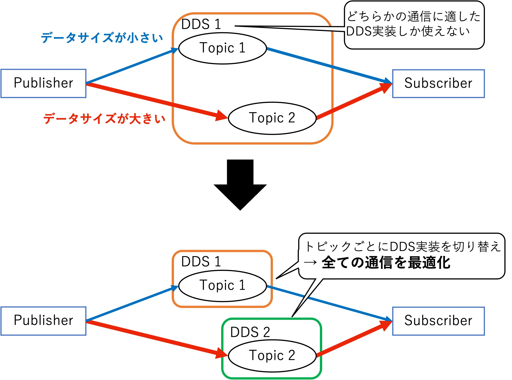

### 実機を用いたロボット制御プログラミング学習に適した VOD 型 e-Learning システム

**瀧本 恒平**  
知能情報科学領域・修士 2 年

- ロボット制御プログラミングには，ソースコードを記述して PC 上で動作させるような通常のプログラミング学習と異なり，ロボットの物理的な装置の挙動について意識する必要がある，という特徴がある
- Web 上に多く存在するソースコードやその解説が記述されたテキスト形式の学習コンテンツでは，ロボットの物理的な装置の挙動を意識しながらの学習は難しい
- 動画やシミュレータによるロボットの動作確認では，プログラムとロボットの動作が実世界で同期して動いていることを見ることができない
- 講義形式の動画の解説に合わせて手元のロボットが連動し，ロボット内で動作しているプログラムの状態理解を支援するシステムを提案

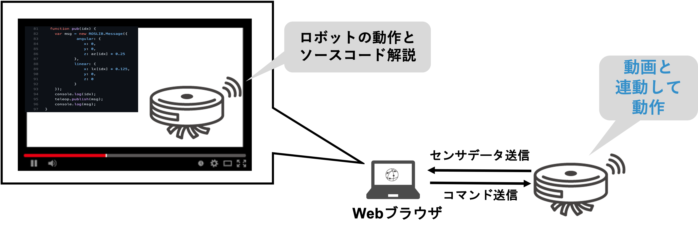

### ロボット制御システムにおける機能モジュールのライブマイグレーション機構

**柿本 翔大**  
情報システムコース・学部 4 年

- ロボット開発には ROS(Robot Operating System) の利用が拡大
- クラウドやロボット上で動作する ROS の機能モジュール ( ノード ) が連携
- 状況に応じて，実行中のノードを再配置することで，負荷調整をしたい
- 異種アーキテクチャのマシン間ではノード ( プロセス ) の実行状態に互換性がないためマイグレーションできない
- ノードを WebAssembly で実行することで異種アーキテクチャ間のノードの実行状態に互換性を持たせることが可能だが，ノードの実行状態復元時にオーバーヘッドが発生する
- ノードだけでなくROSランタイム全体を WebAssembly 化することでオーバーヘッドを減らし，ネイティブと同程度の性能でROSノードを動作させることを目指す

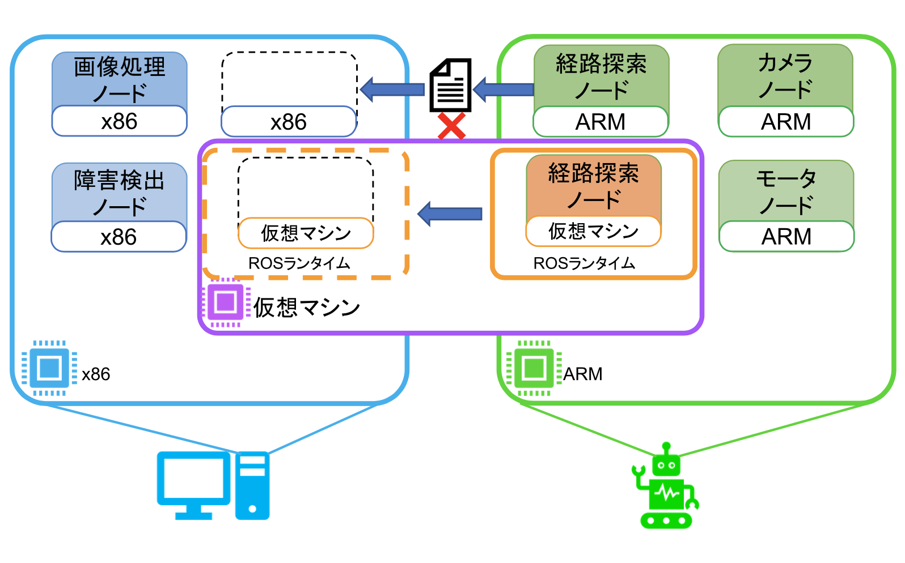

### 連合学習処理を対象としたネットワーク通信機構の最適化に関する研究

**村上 光**  
知能システムコース・学部 4 年

- データプライバシ保護や負荷分散，ネットワーク通信量削減などの諸問題を解決した分散機械学習方式「連合学習」が注目を集めている
- 性能特性の異なる異種デバイスが連合学習に参画すると，学習進捗の差が起因となる偏った学習結果が課題となりうる
- 多くの連合学習フレームワーク実装で採用されているgRPCが用いる下位プロトコルHTTP/2は，計算資源や通信帯域が限られたネットワーク環境でオーバーヘッドが増大することが知られている
- 本研究では，連合学習に最適な通信プロトコルの検討と，gRPCが用いる下位プロトコルをデバイス毎に切り替える機構の実現を行う

### デジタルイラストを対象としたコンテンツストレージの最適化

**吉川 綾乃**  
高度 ICT 領域・修士 2 年

- デジタルイラストなどのアート作品を販売するためのNFT(Non-Fungible Token) サービスでは，データの保管にIPFS(InterPlanetary File System) を利用
- IPFS はコンテンツ指向にもとづいており，データの内容に応じた ID でコンテンツにアクセス
- イラストデータは拡大縮小，色調補正などの加工を施して利用することも
- IPFS では，加工前後のイラストデータを異なるコンテンツとして保管するためストレージを圧迫
- リクエストに応じて，加工後のイラストデータを動的に生成することで，ストレージ圧迫の課題を解決

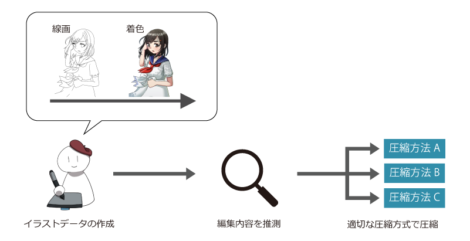

### Inter-Planetary Filesystem における Churn 耐性とコンテンツ取得効率に関する分析

**伊藤 晋梧**  
高度ICT領域・修士 1 年

- Inter-Planetary Filesystem(IPFS)と呼ばれる分散ファイルシステムが現在普及し始めている
- IPFSはWeb3.0の構造を支える技術であり，その性能や仕組みについて研究が行われている
- 現在実現されている中央集権型のシステムとの比較や代替となるかどうかの検証は行われているが，IPFSのコンテンツ指向な特性や非中央集権的な仕組みを用いたことによる変化や影響はあまり検証されていない
- IPFSには，複数ノードがネットワークに頻繁に出入りした時の挙動が実装通りかどうかなど，明らかになっていない点が多く存在している
- IPFSを用いたシステムの開発を行なっても安全かどうか，挙動が正常かどうかを判断する資料がないため，IPFSを用いたシステムの開発が困難になっている
- IPFSの実装の調査や，ネットワークに対して実験を行い，IPFSのChurn耐性やコンテンツ取得の流れ，効率を明らかにする

### P2P 型 Web アーカイブ実現を目指したユーザ透過なアーカイビング機構

**伊藤 璃音**  
情報システムコース・学部 4 年

- 増え続ける Web ページをアーカイブして保存するという取り組みが存在
- 単一の組織での大規模な Web ページの収集が行われている
- Web ページの増加速度に対して Web アーカイブを作成する速度が追いつかず，アーカイブしきれていない
- アーカイブを保存する際に莫大なコストがかかっている
- ブラウザを利用する際のキャッシュを活用して各マシンでユーザ透過に Web アーカイブを作成し，分散ファイルシステムを活用して管理を行う

### 広域に分散した IoT デバイス郡を対象とした P2P 型 OS プロビジョニング

**森川 太斗**  
情報アーキテクチャ領域・修士 1 年

- IoT デバイスは OS などのソフトウェアの管理が重要である一方で，広域に分散して配置されているため管理が煩雑
- 遠隔地から OS などを配布するネットワークブートを用いることでデバイスのソフトウェアを集中管理できるが，大量のデバイスに対してその手法を適応すると動作性能が低下するブートストームが発生
- 広域に分散する IoT デバイスを対象としたブートストームでは，サーバを世界規模で分散させる必要や，ストレージの盗難によるデータの流出に備える必要がある
- 既存のネットワークブートに対して IPFS と呼ばれる分散ファイルシステムの処理機構を導入し，IoT デバイスを対象としたネットワークブート機構を実現

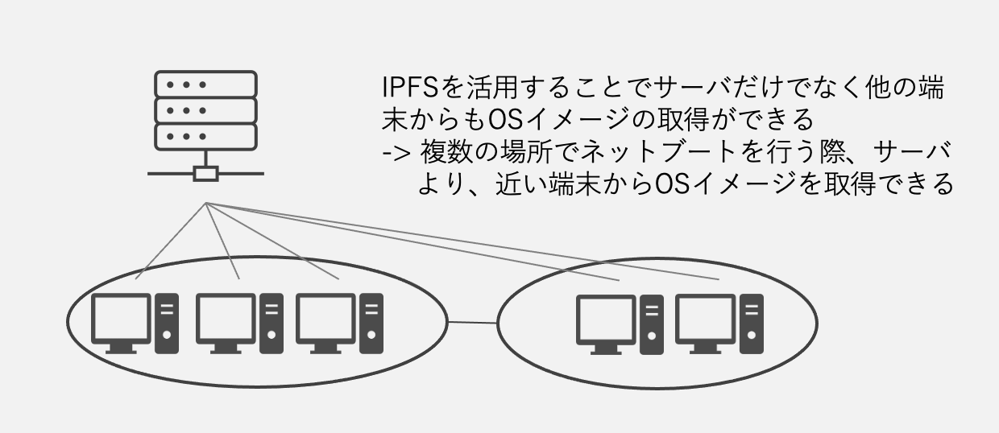

### 超軽量サンドボックスによる高集積エッジクラウド基盤の実現

**石本 直也**  
情報アーキテクチャ領域・修士 1 年

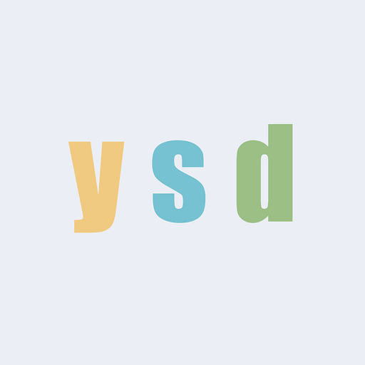

**吉田 龍信**  
高度ICTコース・学部 4 年

- データセンターで構成される従来のクラウド基盤に比べて，，ユーザにより近いところに広域分散配置されるエッジクラウド基盤は，計算資源に制約が大きい
- 従来のクラウド基盤において採用されている仮想化（VM）やコンテナ技術に比べて，より計算資源消費量が少なくできる Webassembly に着目
- 本研究では，WebAssemblyをエッジクラウドの実行基盤として採用するために，WebAssemblyランタイムのさらなる軽量化技術の確立と超軽量化したWebAssemblyインスタンスをクラウド基盤で運用管理するための可観測性を実現
- 従来，プロセスを単位として起動・実行されるWebAssemblyランタイムを，WebAssemblyのメモリ隔離を維持しつつスレッド単位で起動・実行することでさらに軽量化
- スレッド単位で動作しているWebAssemblyランタイム毎の実行メトリック（CPU使用率，メモリ使用量など）の取得を，，WebAssemblyコード変換技術とランタイム機能拡張の組み合わせにより実現

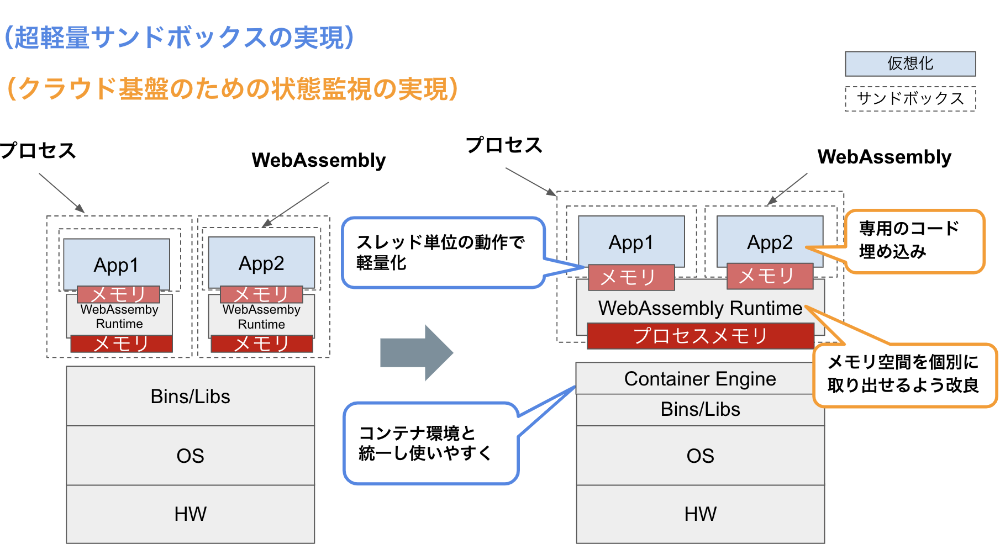

### 異種OS機能連携によるセキュアコンテナの実現

**鈴木 進太郎**  
情報システムコース・学部 4 年

- FaaS（Funtion as a Service）やエッジクラウドなどのクラウド利用形態の進化にともなって，軽量さやDevOpsとの親和性が高いコンテナ型クラウドに注目が集まっている
- 同一ホスト上のコンテナ間ではOSカーネルを共有することになるため，マルチテナント向け高集積クラウド基盤ではのコンテナ間の隔離を強化する必要がある
- 仮想化（VM）技術などの隔離強化技術を組み合わせる手法では，コンテナの軽量さが犠牲になる
- 本研究では，コンテナを実現しているLinuxカーネルに着目し，Linuxカーネルの脆弱性回避と異種OSの隔離技術を組み合わせることで，コンテナの軽量さを維持しつつ隔離を強化したセキュアコンテナを実現する
- 異なるOSカーネル上でLinuxコンテナの実行を可能にすることで，Linuxカーネルに起因する脆弱性への攻撃を回避する
- 異種OSとしてFreeBSDを採用し，Linuxにはないセキュリティ機構capsicumを適用して，OSカーネル呼び出しを検査・制限することで，OSカーネルを保護する

[**過去の卒業研究・修士研究（発表論文へのリンク）**](https://researchmap.jp/ktymtbr/published_papers)

## 研究活動

### 設備

研究室では，学部 4 年生が利用する表部屋と，院生が利用する裏部屋の 2 つが提供されています．

研究室には，高級キーボードや大型ディスプレイ，ドローンやロボットなどのデバイス，PC クラスタやサーバ PC など，こだわりの研究設備が揃っています．

研究室内のメンバーだけでなく，楽しい後輩たちや他の研究室のメンバーともコミュニケーションを取りながら，楽しく研究できます．

### ゼミ

本研究室では，教員と学生の予定に合わせて進捗報告のゼミ 1 回，自分が読んだ論文の紹介をするゼミ 1 回，研究分野の近い者同士でのグループゼミ 1 回の合計 3 回を毎週行っています．

### 学会

研究やゼミを通して順調に成果を出すことで，学会やオープンソース系の会議（RubyKaigi，OSC，Open Source Summit など）に参加することができます．

研究が上手くいけば，海外に行けるかも！？

### イベント

本研究室では，研究以外にもメンバー内での交流を図るために，新歓，BBQ，飲みなどのイベントを開催しています．もちろん，お酒が苦手な人でも気軽に参加できるような雰囲気で楽しんでいます！

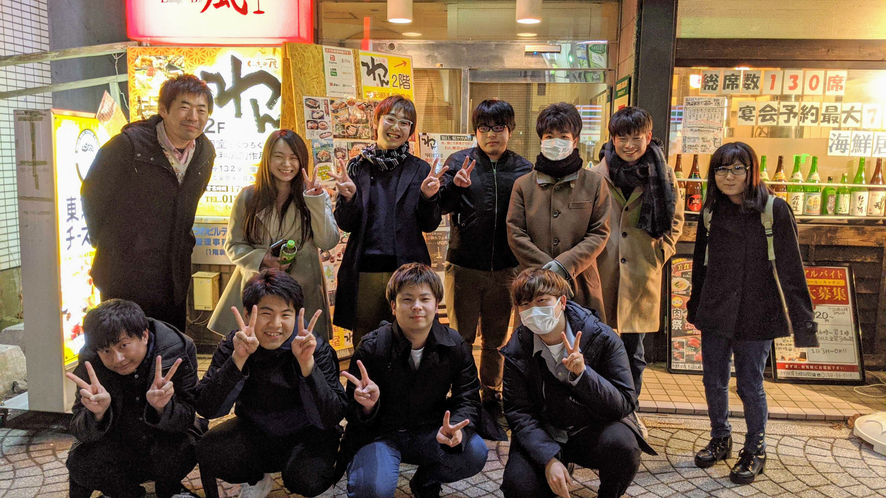

研究室内外に関わらず，本研究室に興味がある人も参加できるかも...？

## 問い合わせ先

## おわりに

当研究室にきて，圧倒的成長しよう！ 
低レイヤ沼が君を待っている！

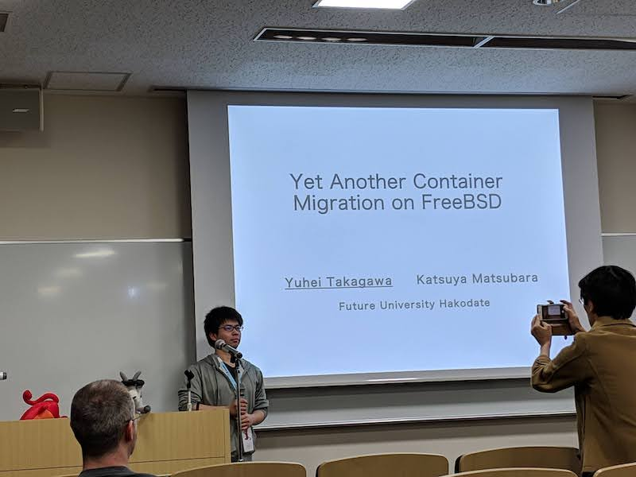

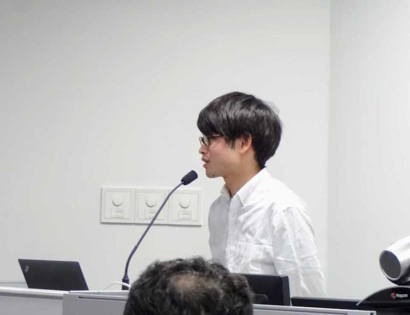

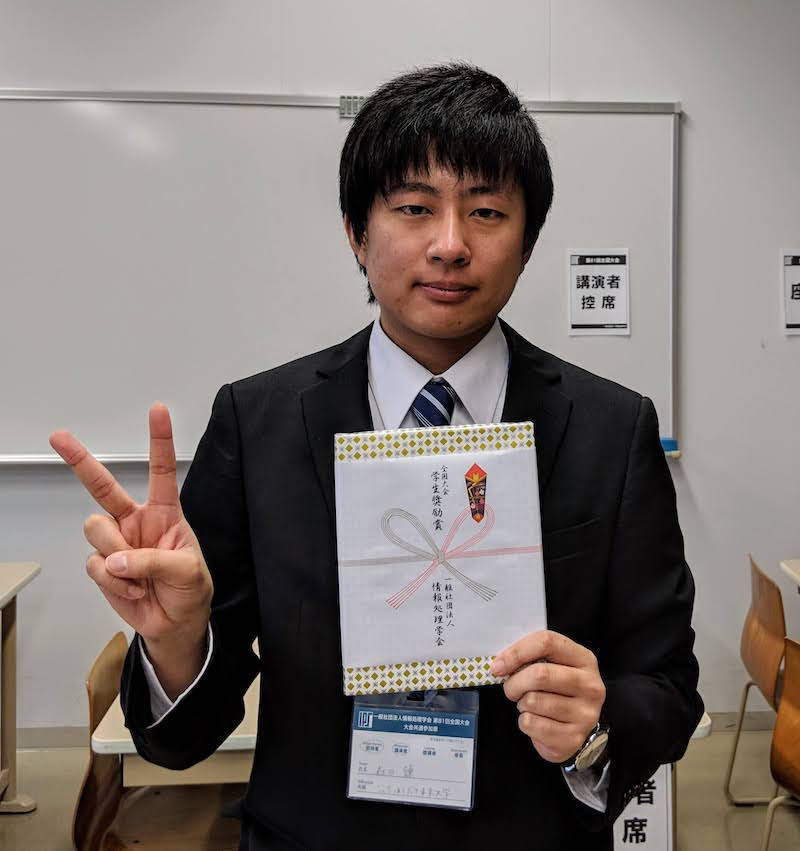

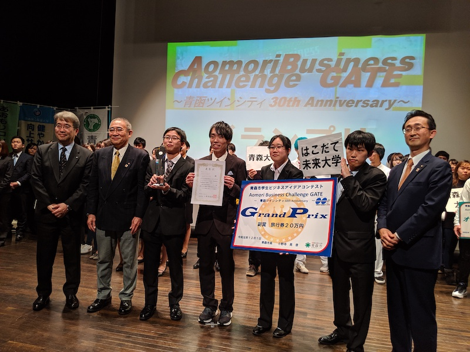

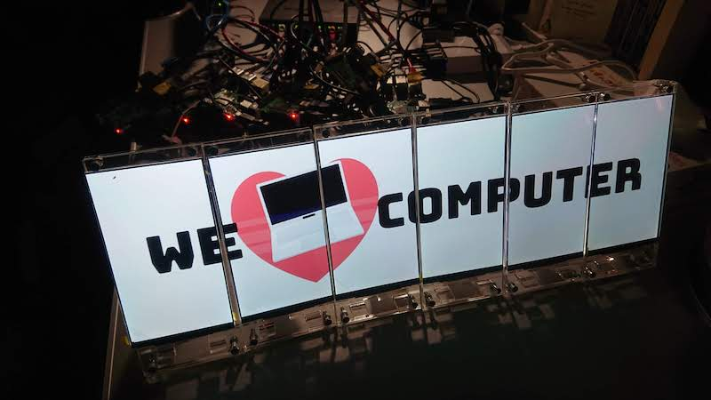

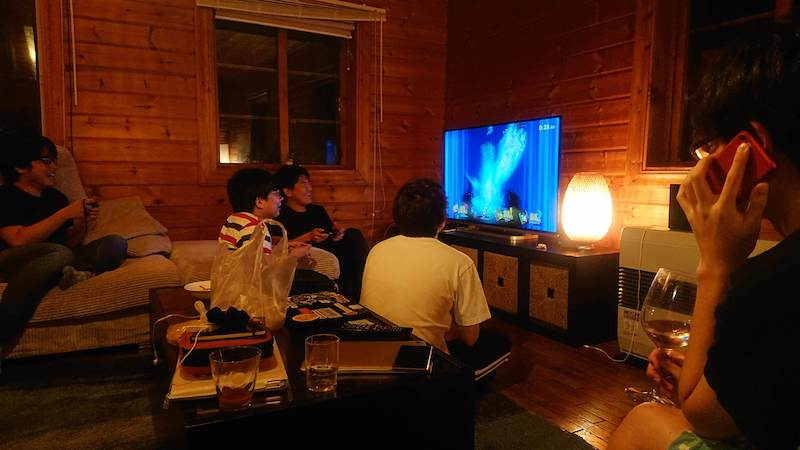

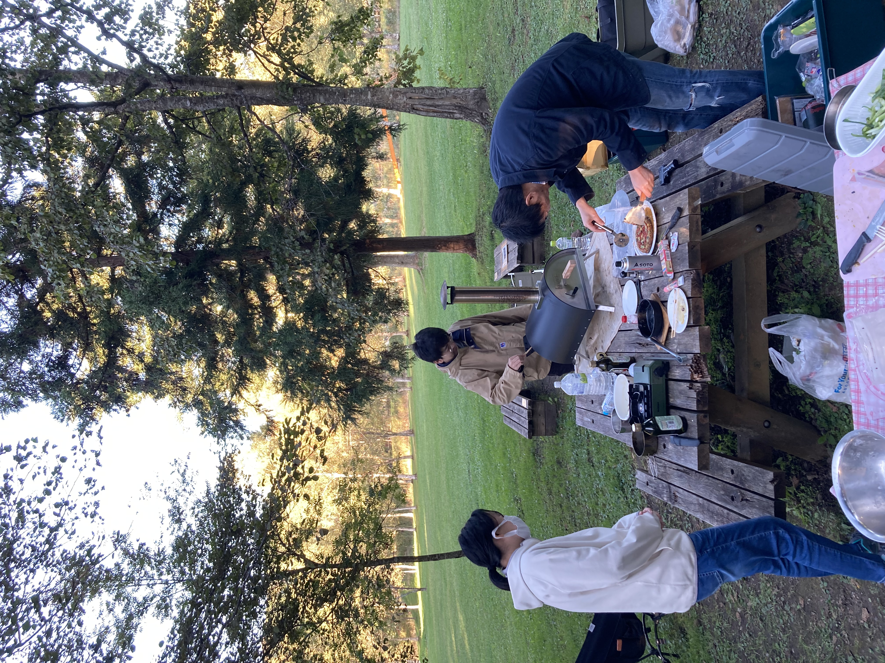
