

## 目次

- [研究室紹介出展概要](#研究室紹介出展概要)
- [システムソフトウェア研究](#システムソフトウェア研究)
- [研究紹介](#研究紹介)
- [研究活動](#研究活動)
- [問い合わせ先](#問い合わせ先)
- [おわりに](#おわりに)

## 研究室紹介出展概要

<h3>to be determined</h3>

## システムソフトウェア研究

本研究室では，システムソフトウェアの研究をとおして，社会で**飛びぬけて活躍できる**エンジニアスキルを身につけることを目指しています．

### システムソフトウェアって何？

システムソフトウェアは，PC やスマホで動く様々なアプリケーションの快適な動作や安心・安全を支える**縁の下の力持ち的**なソフトウェアです．  
代表的なものとして，OS（オペレーティングシステム）があります．  
（例：Windows，Mac，Android，Linux など）

### システムソフトウェアがないとどうなるの？

例えばインターネット... OS がないと，複雑で難解なネットワーク通信を自分で制御しなければならず，ネットサーフィンするのも一苦労です．

例えば，アプリケーションを使うとき... Word や Excel，ゲームや Web ブラウザを同時に使えなかったり，フリーズしたり快適に動作しなかったりします．さらに，システム攻撃や情報漏えいに対して無防備になります．

### システムソフトウェアを研究して，いいことあるの？

#### いいことその１：**ブラックボックスの解明**

Windows や Mac，Android など，システム内の動作や仕組みを理解できるため，システムやアプリケーションのチューンナップ，エラー発生や動作不安定の原因究明に役立ちます．

#### いいことその 2：**最新技術研究とのコラボ**

IoT（Internet of Things）やビッグデータ，クラウドコンピューティングといった最新技術に触れることができます．

#### いいことその 3：**PC やスマホの眠れる力を呼び覚ます**

PC やスマホの性能を引き出し，新たな機能を創造できます．

### こんな人にオススメ

- コンピュータやプログラムが動いている裏側を知りたい！
- 低レイヤに関する技術力を高めたい！
- 松原克弥先生が好き！

#### キーワード

- システムソフトウェア技術（仮想化，ネットワーク，システムプログラミング，並列分散処理など）
- コンピューティング技術（クラウド，IoT など）
- 圧倒的成長
- 松原克弥

## 研究紹介

### 分散型ロボット制御システムにおける機能モジュール間通信機構の最適

**大野 和也**  
知能情報科学領域・卒業

- ROS では，複数のノード間でトピックというデータパスを利用したデータ通信を行い，ロボット制御システムを実現している
- ROS の最新バージョンである ROS 2 では，DDS(Data Distribution Service) によりノード間の通信が実現され，複数のベンダが特徴の異なる DDS 実装を提供している
- ROS 2 ではノードごとに DDS 実装を 1 つしか選択できないため，全てのノード間においてデータサイズや通信レイテンシなどの特性から最適な DDS 実装を利用して通信することは不可能
- トピックごとに DDS 実装を切り替える「DDS Binder」の実現を提案

### 実機を用いたロボット制御プログラミング学習に適した VOD 型 e-Learning システム

**瀧本 恒平**  
知能情報科学領域・卒業

- ロボット制御プログラミングには，ソースコードを記述して PC 上で動作させるような通常のプログラミング学習と異なり，ロボットの物理的な装置の挙動について意識する必要がある，という特徴がある
- Web 上に多く存在するソースコードやその解説が記述されたテキスト形式の学習コンテンツでは，ロボットの物理的な装置の挙動を意識しながらの学習は難しい
- 動画やシミュレータによるロボットの動作確認では，プログラムとロボットの動作が実世界で同期して動いていることを見ることができない
- 講義形式の動画の解説に合わせて手元のロボットが連動し，ロボット内で動作しているプログラムの状態理解を支援するシステムを提案

### ロボット制御システムにおける機能モジュールのライブマイグレーション機構

**柿本 翔大**  
情報システムコース・卒業

- ロボット開発には ROS(Robot Operating System) の利用が拡大
- クラウドやロボット上で動作する ROS の機能モジュール ( ノード ) が連携
- 状況に応じて，実行中のノードを再配置することで，負荷調整をしたい
- 異種アーキテクチャのマシン間ではノード ( プロセス ) の実行状態に互換性がないためマイグレーションできない
- ノードを WebAssembly で実行することで異種アーキテクチャ間のノードの実行状態に互換性を持たせることが可能だが，ノードの実行状態復元時にオーバーヘッドが発生する
- ノードだけでなくROSランタイム全体を WebAssembly 化することでオーバーヘッドを減らし，ネイティブと同程度の性能でROSノードを動作させることを目指す

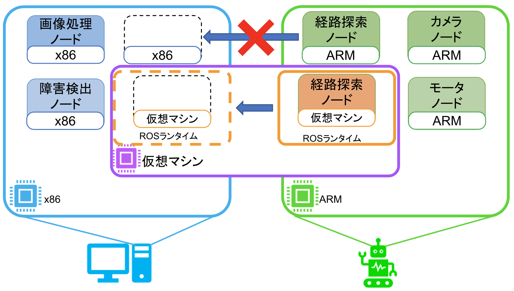

### 連合学習処理を対象としたネットワーク通信機構の最適化に関する研究

**村上 光**  
知能システムコース・卒業

- データプライバシ保護や負荷分散，ネットワーク通信量削減などの諸問題を解決した分散機械学習方式「連合学習」が注目を集めている
- 性能特性の異なるデバイスが連合学習に参画すると，学習進捗の差が起因となる偏った学習結果が課題となりうる
- 多くの連合学習フレームワーク実装で採用されているgRPCが用いる下位プロトコルHTTP/2は，計算資源や通信帯域が限られたネットワーク環境でオーバーヘッドが増大することが知られている
- 本研究では，連合学習に最適な通信プロトコルの検討と，gRPCが用いる下位プロトコルをデバイス毎に切り替える機構の実現を行う

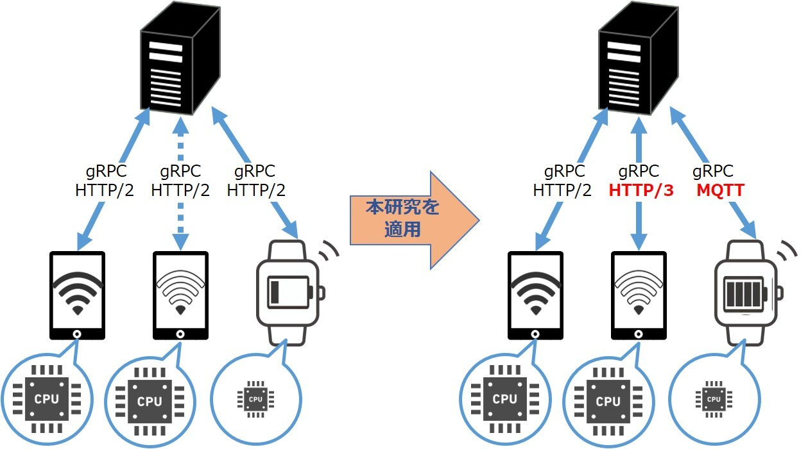

### デジタルイラストを対象としたコンテンツストレージの最適化

**吉川 綾乃**  
高度 ICT 領域・卒業

- デジタルイラストなどのアート作品を販売するためのNFT(Non-Fungible Token) サービスでは，データの保管にIPFS(InterPlanetary File System) を利用
- IPFS はコンテンツ指向にもとづいており，データの内容に応じた ID でコンテンツにアクセス
- イラストデータは拡大縮小，色調補正などの加工を施して利用することも
- IPFS では，加工前後のイラストデータを異なるコンテンツとして保管するためストレージを圧迫
- リクエストに応じて，加工後のイラストデータを動的に生成することで，ストレージ圧迫の課題を解決

### Inter-Planetary Filesystem における Churn 耐性とコンテンツ取得効率に関する分析

**伊藤 晋梧**  
高度ICT領域・修士 2 年

- Inter-Planetary Filesystem(IPFS)と呼ばれる分散ファイルシステムが現在普及し始めている
- IPFSはWeb3.0の構造を支える技術であり，その性能や仕組みについて研究が行われている
- 現在実現されている中央集権型のシステムとの比較や代替となるかどうかの検証は行われているが，IPFSのコンテンツ指向な特性や非中央集権的な仕組みを用いたことによる変化や影響はあまり検証されていない
- IPFSには，複数ノードがネットワークに頻繁に出入りした時の挙動が実装通りかどうかなど，明らかになっていない点が多く存在している
- IPFSを用いたシステムの開発を行なっても安全かどうか，挙動が正常かどうかを判断する資料がないため，IPFSを用いたシステムの開発が困難になっている
- IPFSの実装の調査や，ネットワークに対して実験を行い，IPFSのChurn耐性やコンテンツ取得の流れ，効率を明らかにする

### P2P 型 Web アーカイブ実現を目指したユーザ透過なアーカイビング機構

**伊藤 璃音**  
情報システムコース・卒業

- 増え続ける Web ページをアーカイブして保存するという取り組みが存在
- 単一の組織での大規模な Web ページの収集が行われている
- Web ページの増加速度に対して Web アーカイブを作成する速度が追いつかず，アーカイブしきれていない
- アーカイブを保存する際に莫大なコストがかかっている
- ブラウザを利用する際のキャッシュを活用して各マシンでユーザ透過に Web アーカイブを作成し，分散ファイルシステムを活用して管理を行う

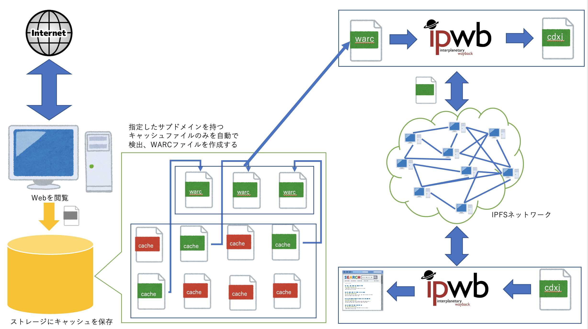

### 広域に分散した IoT デバイス郡を対象とした P2P 型 OS プロビジョニング

**森川 太斗**  
情報アーキテクチャ領域・修士 2 年

**熊谷　竣**  
情報アーキテクチャ領域・修士 2 年

- インターネット上の様々な攻撃にさらされる IoT デバイスは、ソフトウェアアップデートなど適切なセキュリティ対策が必要不可欠
- 一方で、 IoT デバイスは広域に分散して配置されているため管理が煩雑
- サーバから OS イメージを動的に取得しつつデバイスを起動するネットワークブートは効率的な管理を実現できる
- 大量のデバイスを一斉起動した際、サーバに集中する負荷で起動時間が増加する「ブートストーム」が発生
- P2P を用いた OS イメージの分散管理を導入することで課題の解決を図り、独自のテストベッドを用いて研究の有効性を評価

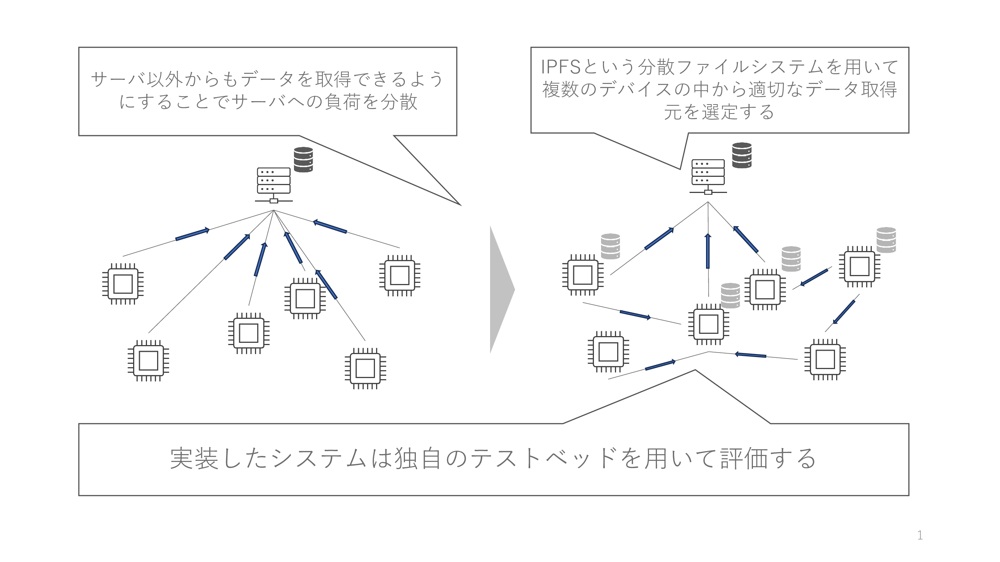

### WebAssembly ランタイムにおける計算リソース利用量の監視・制御

**石本 直也**  
情報アーキテクチャ領域・修士 2 年

**斉藤　優月**  
情報システムコース　4 年

**吉田 龍信**  
高度ICTコース・卒業

- エッジコンピューティング基盤でのアプリケーション実行環境として計算資源消費量や起動速度の面で優れているWebAssembly(Wasm) に注目
- 既存 Wasm ランタイムの計算リソース制御は、指定した独自の実行コスト（Gasコスト）を超えた場合、プログラムの強制終了による制限のみ
- Wasmアプリケーションごとの実行状態（メモリ使用量、CPU使用率など）の取得をLinuxカーネルの機能とWasmRuntimeの機能を活用し実現する
- 計算機基盤（OS）は、時間当たりの CPU 実行割合で管理しているため、Gasコストを各CPU毎の実行時間に変換し、Wasmの実行を時間当たりのコスト消費量で制御する機構を実現
- これにより、計算資源の限られたクラウド基盤において柔軟で効率的な計算リソース割り当てが可能となる

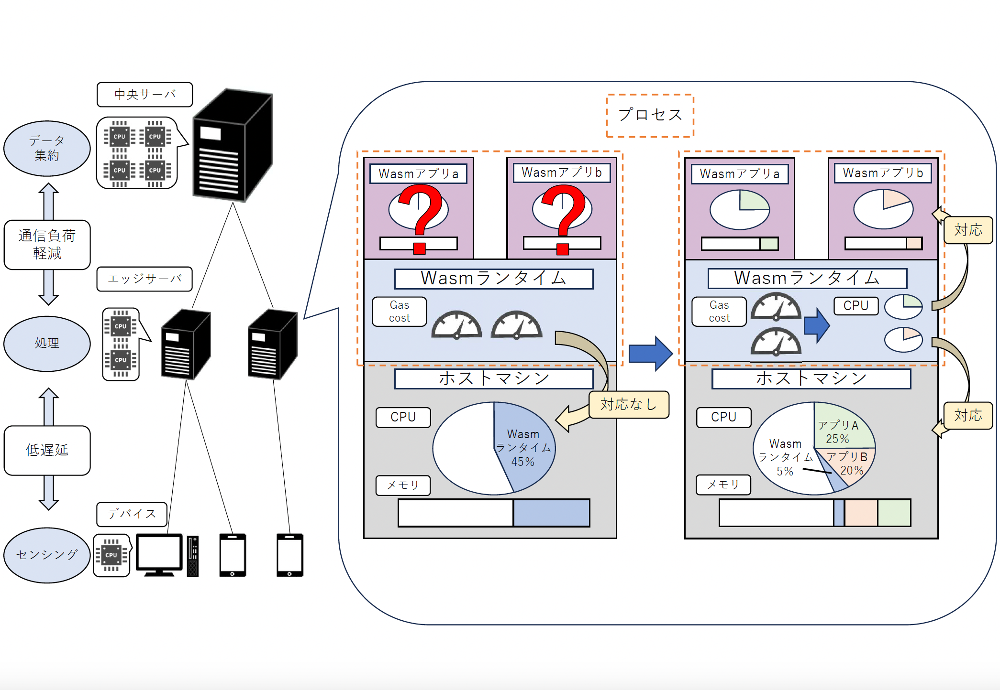

### 異種OS機能連携によるセキュアコンテナの実現

**鈴木 進太郎**  
情報アーキテクチャ領域・修士 1 年

**坂口　颯麻**  
情報システムコース　4 年

- Linux で実現され広く普及したコンテナ型仮想化は、 OS カーネルをコンテナ間で共有することで、軽量かつ高速に起動することができる一方、カーネル脆弱性を悪用した攻撃によりコンテナ間隔離が脆弱となるリスク
- ハードウェア仮想化技術やシステムコール検査などの手法と比較して、Linux 以外の OS カーネル上で Linux コンテナを動作可能とすることで、Linux カーネルの脆弱性を利用した攻撃を低オーバヘッドで回避
- 異種 OS が持つ独自のセキュリティ機能を透過的適用することで、ファイル I/O やネットワークを利用した攻撃に対しても効率的な防御を実現

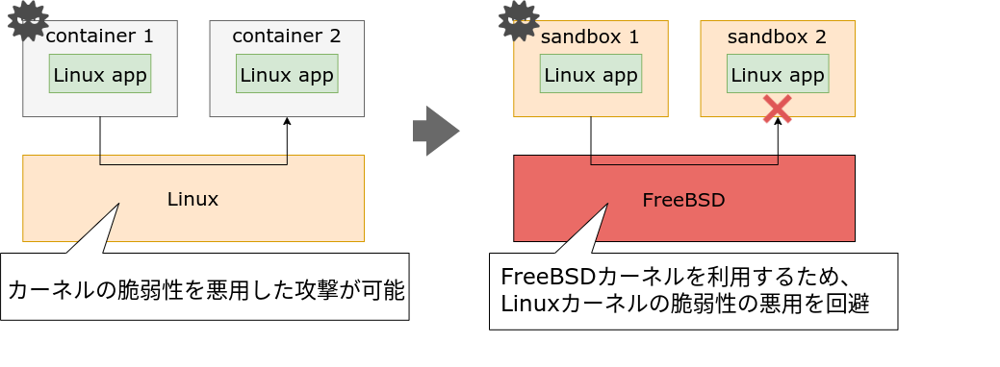

### ランタイム実装中立なWebAssemblyライブマイグレーション

**藤井　大吾**  
高度ICTコース　4 年

- IoT や AI の技術進歩により、多くの IoT デバイスが大量のデータを生成し、データ転送による通信遅延が大きくなるので、デバイス付近にエッジサーバを配置するエッジクラウドが普及
- エッジクラウドはクラウド・エッジサーバ・デバイスから構成され、各層のマシンや地理的特徴から処理性能と通信遅延のトレードオフが発生
- WebAssembly(Wasm) を用いて、エッジクラウドにおけるクラウド層・エッジサーバ層・デバイス層間でアプリをマイグレーションすることで、処理性能と通信遅延のトレードオフを柔軟に変更可能に
- 異種 Wasm ランタイム間でマイグレーションを実現することで各環境や用途に合わせたWasm ランタイムを選択

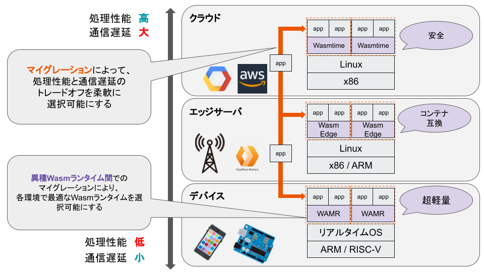

### クラウドドボティクスに適したロボット基盤ソフトウェアに関する研究

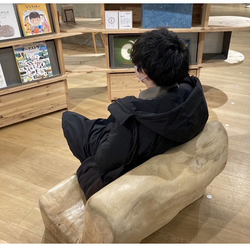

**中村　碧**  
知能システムコース　4 年

- ロボットとクラウドが連携することで高度な知能処理と低遅延な制御処理を両立できるクラウドロボティクスでは、システム起動時に各機能モジュールをロボットとクラウドへ分散配置することが必要
- バッテリ残やネットワーク状況の変化などが要因となり、モジュール配置構成が最適ではなくなる可能性
- CPUアーキテクチャが異なるロボットとクラウド間でROS（Robot Operating System）ノードの配置を動的に再構成できるようにするために、WebAssemblyを用いた軽量でアーキテクチャ中立なROSランタイムを実現
- 災害時などの環境が変化する場合に対しても、ロボットとクラウド間での処理分担を柔軟に再構成・最適化することで、ロボット制御の継続実行を可能にする
- WebAssemblyの導入でランタイムのオーバーヘッドが増加するため、軽量設計のmros2を採用。ROS側のオーバーヘッドを低減させることで、ネイティブROSのオーバーヘッドに近づけた

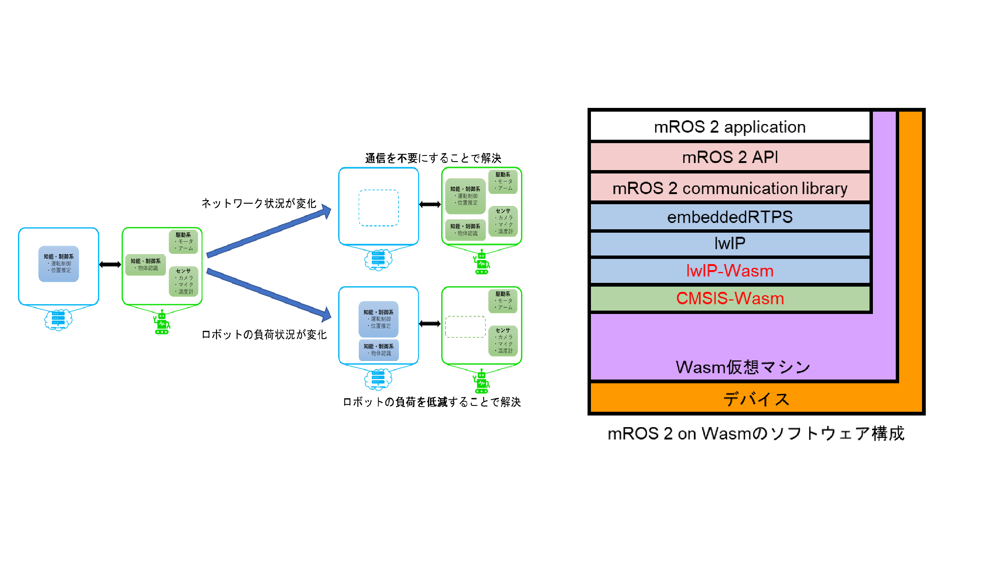

### 連合学習処理における通信方式の最適化

**東　未来翔**  
知能システムコース　4 年

- プライバシーの保護や、通信料の低減、学習処理の分散等の利点から機械学習の方式の一つである「連合学習」が使用されている
- 回線品質の低いクライアントが参加したすると、学習の進捗全体が阻害されるという課題がある
- 多くの連合学習フレームワークがTCPベースの通信方式を採用している
TCPの信頼性保障の仕組みは、低質な回線においてはオーバーヘッドを増大させることが知られる
-本研究では、連合学習の通信にUDPをベースとするDDSを採用し、上記課題の解決とQoS（Quality of Service）の制御によるより効率的な通信を目指す

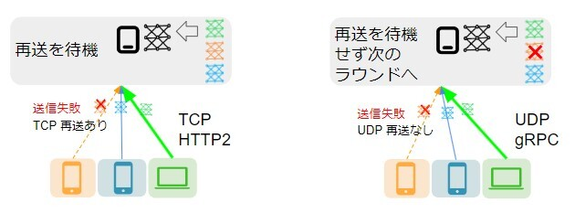

### キャンパスDXに向けた学務情報のオープンデータ化

**中川　匠海**  
情報システムコース　4 年

- 今日の大学では、LMS（Learning Management System）や教務システムなど、それぞれの目的に応じた複数のシステムを組み合わせたICT学修支援環境を構築している
- 複数のシステムに必要な情報が分散していることや、Webサイトやメール等の限られたアクセス手段しか提供されないことで、学生に対する「学務情報への到達容易性」が課題となっている
- 複数のシステムでそれぞれ異なる形式で分散管理されている学務情報（休講・振替連絡、課題〆切、教室空き状況など）をスクレイピング技術等を用いて収集し、モバイルアプリなどで活用できるようにオープンデータ化する
- スマートフォンやSNSなどの情報アクセス媒体に慣れた「ディジタルネイティブ世代」の学生に適した学修支援の実現を目指す

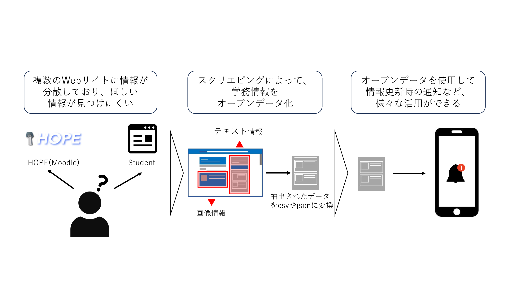

### 空港手荷物受け取り所におけるVPSを利用したWebARアプリケーションの提案

**池田　 呼人**  
情報システムコース　4 年

- 手荷物を機内へ持ち込む旅客の増加は、飛行機遅延要因の一つ
- 荷物を預けることが忌避される要因として、閑暇な空間である手荷物受取所
で終わりが予測できない時間の待機が旅客の不満を生んでいる現状
- 手荷物受取所の設備を活かした情報提供手段として、ベルトコンベアを利用
して「回転すし」スタイルの体験をとおしたグルメ情報閲覧サービスを実現
- 閑暇を解消することで、手荷物預けに対する忌避感の減少を減少し、飛行機
遅延の改善に貢献
- オブジェクトをベルト上の正しい位置へ配置するために屋内外で利用できる位置推定技術VPS(Visual Positioning System)を活用

[**過去の卒業研究・修士研究（発表論文へのリンク）**](https://researchmap.jp/ktymtbr/published_papers)

## 研究活動

### 設備

研究室では，学部 4 年生が利用する表部屋と，院生が利用する院生室と裏部屋の 3 つが提供されています．

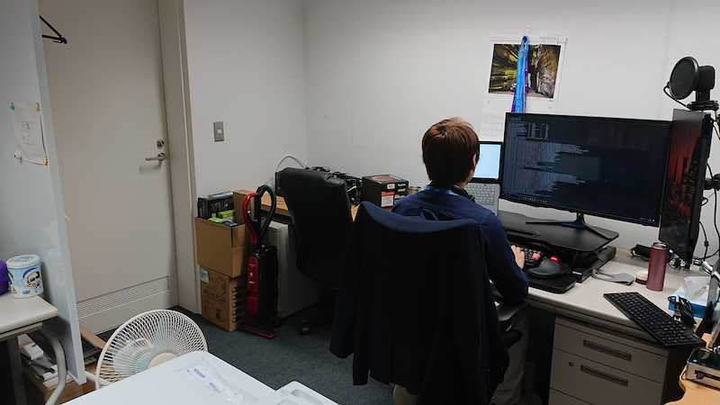

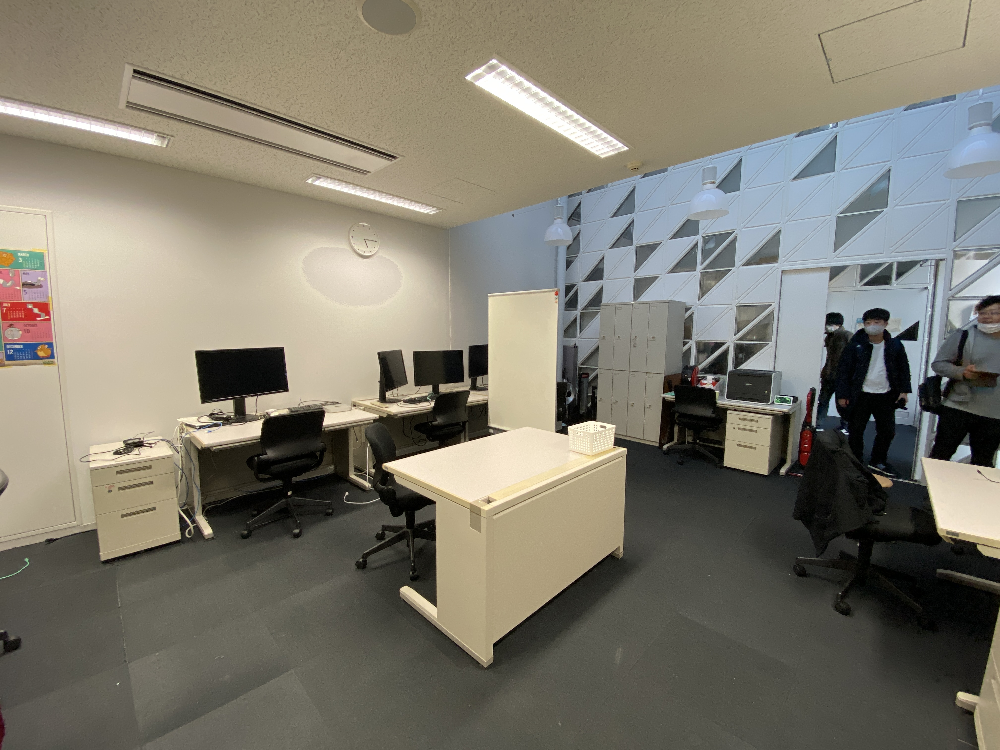

研究室には，高級キーボードや大型ディスプレイ，ドローンやロボットなどのデバイス，PC クラスタやサーバ PC など，こだわりの研究設備が揃っています．

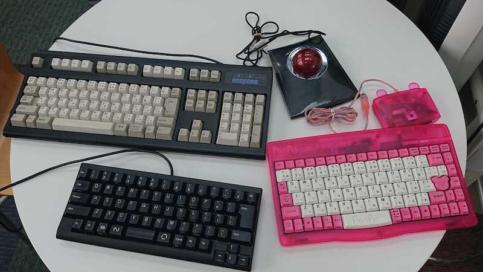

研究室内のメンバーだけでなく，楽しい後輩たちや他の研究室のメンバーともコミュニケーションを取りながら，楽しく研究できます．

### ゼミ

本研究室では，教員と学生の予定に合わせて進捗報告のゼミ 1 回，自分が読んだ論文の紹介をするゼミ 1 回，研究分野の近い者同士でのグループゼミ 1 回の合計 3 回を毎週行っています．

### 学会

研究やゼミを通して順調に成果を出すことで，学会やオープンソース系の会議（RubyKaigi，OSC，Open Source Summit など）に参加することができます．

研究が上手くいけば，海外に行けるかも！？

### イベント

本研究室では，研究以外にもメンバー内での交流を図るために，新歓，BBQ，飲みなどのイベントを開催しています．もちろん，お酒が苦手な人でも気軽に参加できるような雰囲気で楽しんでいます！

研究室内外に関わらず，本研究室に興味がある人も参加できるかも...？

## 問い合わせ先

## おわりに

当研究室にきて，圧倒的成長しよう！ 
低レイヤ沼が君を待っている！

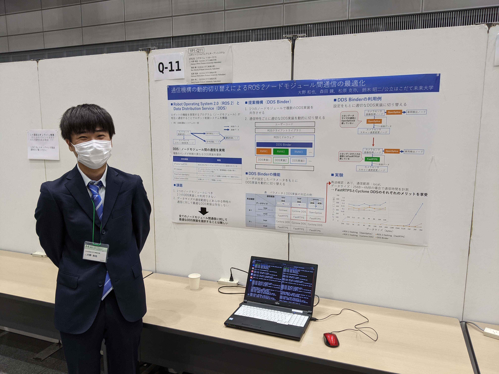

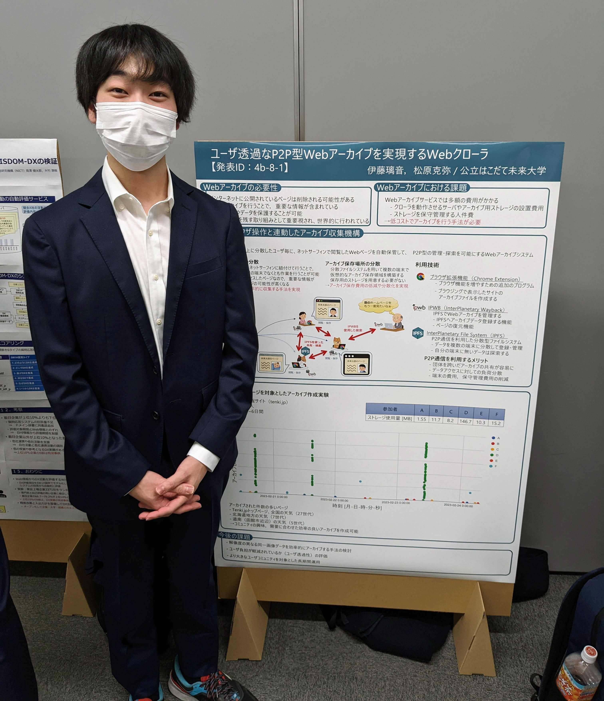

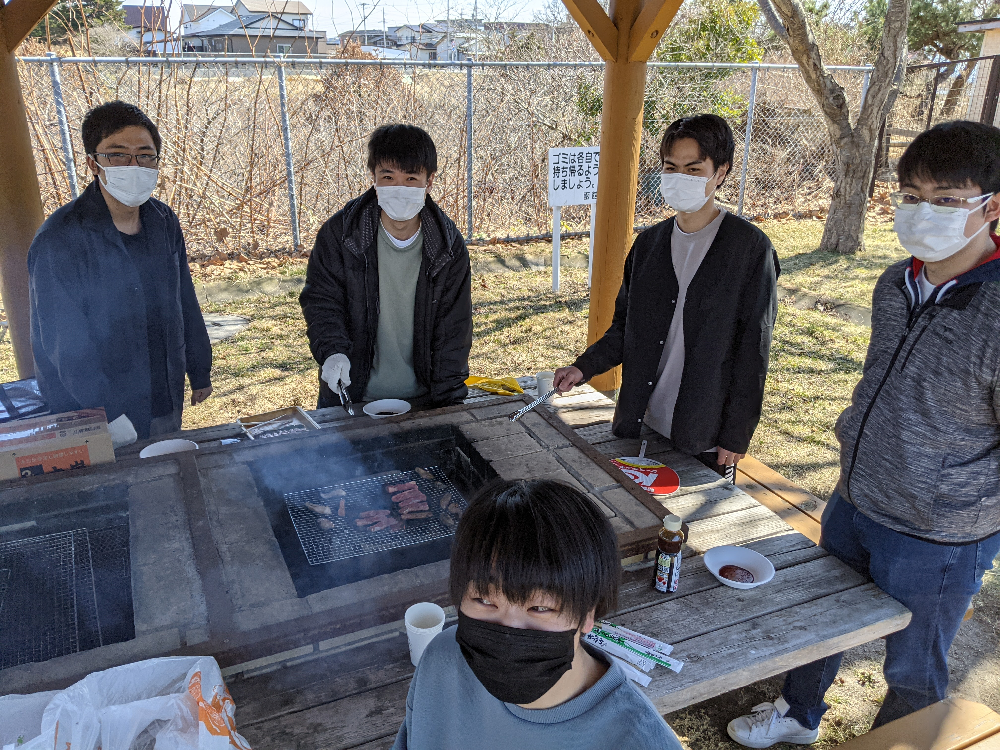

