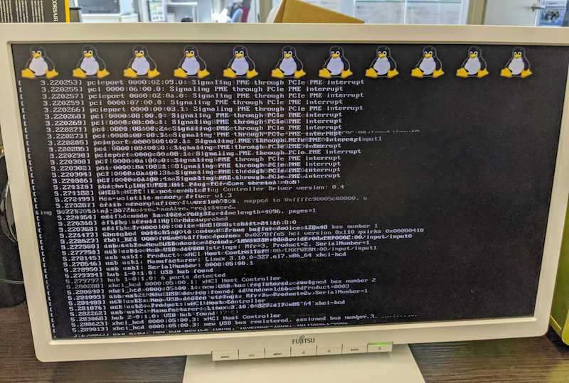

## 目次

- [研究室紹介出展概要](#研究室紹介出展概要)
- [システムソフトウェア研究](#システムソフトウェア研究)
- [研究紹介](#研究紹介)
- [研究活動](#研究活動)
- [問い合わせ先](#問い合わせ先)
- [おわりに](#おわりに)

## 研究室紹介出展概要

- オープンラボ当日は，対面にて，下記の催しを行います．
    - BadUSB危機一髪
    - 異空間鉄道86-64
    - ROSFit Adventure
    - 堅（Kata）いコンテナ
    - IoTでIaT（イルミネーション as Terraform）

## システムソフトウェア研究

本研究室では，システムソフトウェアの研究をとおして，社会で**飛びぬけて活躍できる**エンジニアスキルを身につけることを目指しています．

### システムソフトウェアって何？

システムソフトウェアは，PC やスマホで動く様々なアプリケーションの快適な動作や安心・安全を支える**縁の下の力持ち的**なソフトウェアです．  
代表的なものとして，OS（オペレーティングシステム）があります．  
（例：Windows，Mac，Android，Linux など）

### システムソフトウェアがないとどうなるの？

例えばインターネット... OS がないと，複雑で難解なネットワーク通信を自分で制御しなければならず，ネットサーフィンするのも一苦労です．

例えば，アプリケーションを使うとき... Word や Excel，ゲームや Web ブラウザを同時に使えなかったり，フリーズしたり快適に動作しなかったりします．さらに，システム攻撃や情報漏えいに対して無防備になります．

### システムソフトウェアを研究して，いいことあるの？

#### いいことその１：**ブラックボックスの解明**

Windows や Mac，Android など，システム内の動作や仕組みを理解できるため，システムやアプリケーションのチューンナップ，エラー発生や動作不安定の原因究明に役立ちます．

#### いいことその 2：**最新技術研究とのコラボ**

IoT（Internet of Things）やビッグデータ，クラウドコンピューティングといった最新技術に触れることができます．

#### いいことその 3：**PC やスマホの眠れる力を呼び覚ます**

PC やスマホの性能を引き出し，新たな機能を創造できます．

### こんな人にオススメ

- コンピュータやプログラムが動いている裏側を知りたい！
- 低レイヤに関する技術力を高めたい！
- 松原克弥先生が好き！

#### キーワード

- システムソフトウェア技術（仮想化，ネットワーク，システムプログラミング，並列分散処理など）
- コンピューティング技術（クラウド，IoT など）
- 圧倒的成長
- 松原克弥

## 研究紹介

### ランタイム中立なWebAssemblyマイグレーションの実現

**中田 裕貴**  
博士 1 年

**藤井 大悟**  
高度ICT領域・修士 1 年

**齊藤 優月**  
情報アーキテクチャ領域・修士 1 年

**酒井 佑馬**  
情報システムコース・4 年

- **エッジクラウド：IoTやAIによって発生した膨大なデータを処理する**
異種計算機混合による分散連携処理機構
    - データセンタの高速な計算資源（クラウド）と
    デバイス近傍の低通信遅延な計算資源（エッジサーバ）が連携
    - クラウドでは高性能なIntel CPU、エッジでは低消費電力なARM CPUなど
    異なる性質のハードウェアが混合
- **WebAssembly：エッジクラウドの異種計算機連携を実現するアプリケーション実行環境**
    - あらゆる計算機環境でプログラムを実行する仮想マシン
- **ライブマイグレーションは分散連携処理を実現するコア技術だが、Wasmでは難しい**
    - 実行中のソフトウェアと処理状態を別の計算機環境に移動・再配置し処理を継続する技術
- 研究課題1: 異種環境でのWasmライブマイグレーション（中田・藤井・酒井）
    - エッジとクラウドでは最適なWasm実行環境・方式は異なるが、それらの間でアプリケーション実行状態に互換性がなく、ライブマイグレーションができない
    - アプリケーション状態はWasm仮想マシンだけではなく、OSのファイルなど広範囲に四散
    - **実行状態の統一表現への変換やライブマイグレーションに適したランタイム拡張の実現**
    - **OSの内部状態取得手法を組み合わせたWasmライブマイグレーションの実現**
- 研究課題2：Wasmライブマイグレーションの分散処理管理システムへの統合（斎藤）
    - Kubernetesなどの、デファクトスタンダードな分散処理環境の管理システムは、
    地理的分散やデバイス・エッジ・クラウドの階層構造を意識したアプリケーション再配置ができない
    - **研究課題1の提案を、Kubernetesのアプリケーション再配置ロジックに適用し
    Kubernetesにおけるエッジクラウドの特性を活かした再配置を実現**

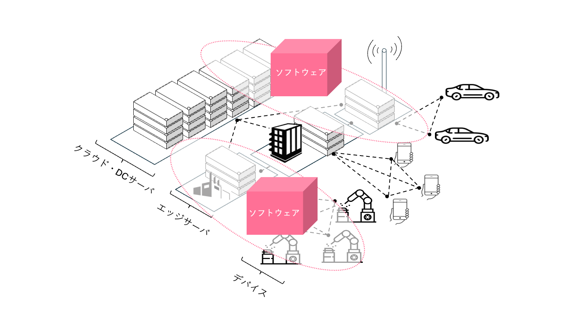
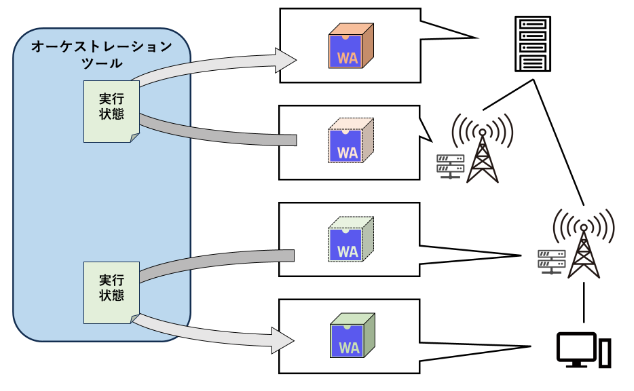

### IoTデバイス郡を対象としたP2P型ネットワークブート機構の最適化

**伊藤 晋梧**  
高度ICT領域・修士 2 年

- Inter-Planetary Filesystem(IPFS)と呼ばれる分散ファイルシステムが現在普及し始めている
- IPFSはWeb3.0の構造を支える技術であり，その性能や仕組みについて研究が行われている
- 現在実現されている中央集権型のシステムとの比較や代替となるかどうかの検証は行われているが，IPFSのコンテンツ指向な特性や非中央集権的な仕組みを用いたことによる変化や影響はあまり検証されていない
- IPFSには，複数ノードがネットワークに頻繁に出入りした時の挙動が実装通りかどうかなど，明らかになっていない点が多く存在している
- IPFSを用いたシステムの開発を行なっても安全かどうか，挙動が正常かどうかを判断する資料がないため，IPFSを用いたシステムの開発が困難になっている
- IPFSの実装の調査や，ネットワークに対して実験を行い，IPFSのChurn耐性やコンテンツ取得の流れ，効率を明らかにする

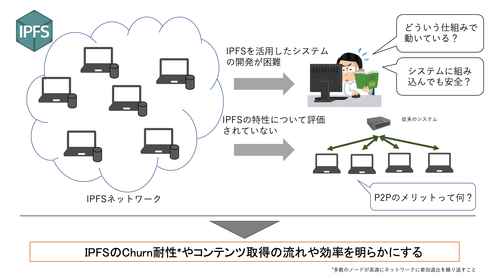

### mROS2-Wasmにおける機能モジュール間RPC通信機能の実装と評価

**石本 直也**  
情報アーキテクチャ領域・修士 2 年

- ロボットとクラウドが連携することで高度な知能処理と低遅延な制御処理を両立できるクラウドロボティクスが注目
- WebAssemblyを用いたCPUアーキテクチャ中立なROSランタイムmROS2-Wasmにより、ロボットとクラウド間でROSノード単位の配置を動的に再構成が可能
- mROS2がサポートするpub/sub通信のみでは、複数ノードかつ、処理の能力差を考慮したタスク分散処理を前提とするアプリケーションを処理できない
- pub/sub通信をベースとした外部ノード関数の呼び出し処理（RPC）を可能とすることで、より高度な分散処理・配置構成可能なクラウドロボット基盤の実現
- mROS2-Wasmにおいて機能モジュール間のRPCを可能とする通信機能を実現、マイグレーション時の処理継続性について評価

<!-- 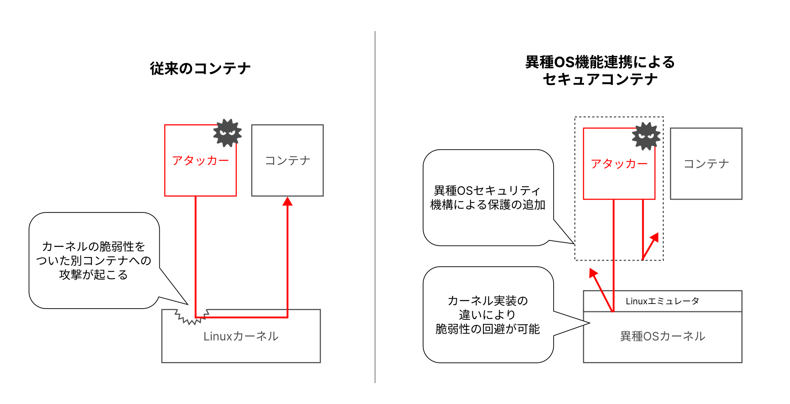 -->

### 異種OS機能連携によるセキュアコンテナの実現

**鈴木 進太郎**  
情報アーキテクチャ領域・修士 2 年

- Linuxで実現され広く普及したコンテナ型仮想化は、 OSカーネルをコンテナ間で共有することで、軽量かつ高速に起動することができる一方、カーネル脆弱性を悪用した攻撃によりコンテナ間隔離が脆弱となるリスクが存在
- Linux以外のOS カーネル上でLinuxコンテナを動作可能とすることで、ハードウェア仮想化技術やシステムコール検査などのコンテナ間隔離手法と比較して、低オーバーヘッドかつ強固なコンテナ間隔離を実現
- 異種OSが持つ独自のセキュリティ機能をコンテナに適用することで、ライブラリやアプリケーションの脆弱性による攻撃を無効化・影響範囲の最小化

### 異種OS機能連携のためのセキュアコンテナネットワーキング機構の実現

**坂口 颯麻**  
情報アーキテクチャ領域・修士 1 年

- ”異種OS機能連携によるセキュアコンテナの実現”では、セキュアなコンテナネットワーキングに関しては未検討
- 複数ノードが動作するクラウドコンピューティング基盤上では、コンテナ間で多数の通信が発生することから、コンテナネットワーキングが重要な機能
- 頻繁なコンテナ間通信を悪用した中間者攻撃などの、コンテナネットワークに対する攻撃への対処も必要不可欠
- 異種OS機能連携によるセキュアコンテナをクラウドコンピューティング基盤へ導入することを想定し、Linux標準のコンテナネットワーキング機構を異種OS上に移植することで、Linuxと同等の複数ノード上コンテナ間通信を実現
- 異種OS独自のセキュリティ機構を用いた、ネットワークリソースへのアクセスの検査・代理実行によって、ネットワークを悪用したコンテナへの攻撃を回避

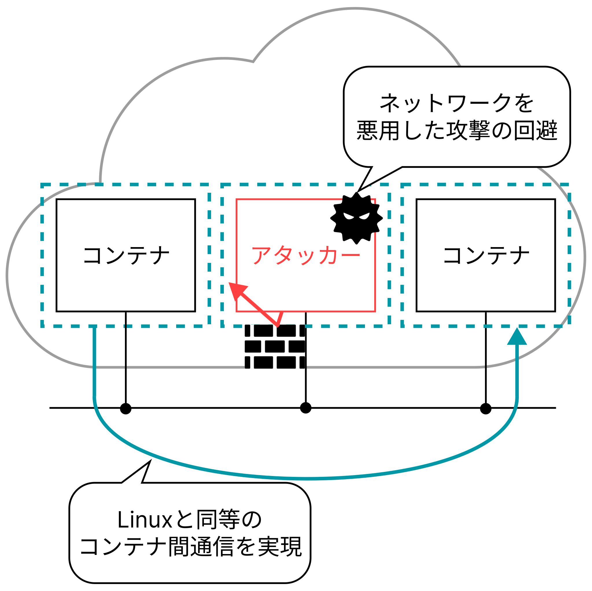
<!-- ### ランタイム中立なWebAssemblyライブマイグレーションの実現 -->

### 異種OS機能連携のためのセキュアコンテナ・ネットワーキング機構の実現

### 空港手荷物受取所向け拡張現実型情報提示システムの社会実装

**中村 碧**  
情報アーキテクチャ領域・修士 1 年

- 手荷物を機内へ持ち込む旅客の増加により収納時間が増大し遅延率が増加している。手荷物を預けることが忌避される要因は、荷物がいつ来るか分からない中待機を強制されることで発生
- 手荷物受取所のベルトコンベアを利用した「回転すし」スタイルのグルメ情報閲覧サービスのテストリリースが実現
- テストリリースの評価では、インストール率3%でサービス利用者が少ない、コンテンツ量が少ないためサービス利用時間が短いという評価
- サービスを利用するためにインストールを必要とする実装が、サービス利用までのハードルになっている。また、グルメコンテンツ作成のプロセスは、多くの時間を要するため大量にコンテンツ作成が難しい
- Webアプリケーション化とグルメコンテンツ作成の半自動化を行うことでテストリリースの問題点を解決し、ちょいぐるの社会実装を目指す

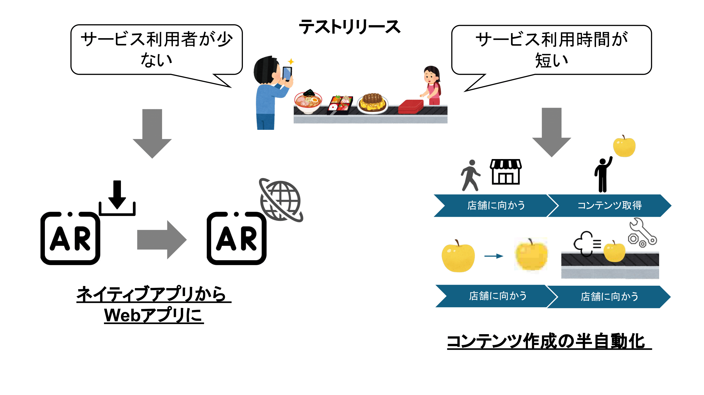

### 無線通信を想定したロボット制御ミドルウェア ROS 2 の通信機構に関する評価

**川平 覚士**  
知能システムコース・4 年

- 近年無線通信環境下にて運用されるロボットが増加
- ROS2(Robot Operating System 2)がnode間通信に使用している通信機構の評価は、主に有線環境下にて行われており無線通信環境下ではあまり行われていない。
- ROS2がnode間通信に使用している通信方式は無線通信と相性が悪いとされており、通信に対する影響があるとされている。
- 無線通信環境下におけるROS2node間通信の性能を評価

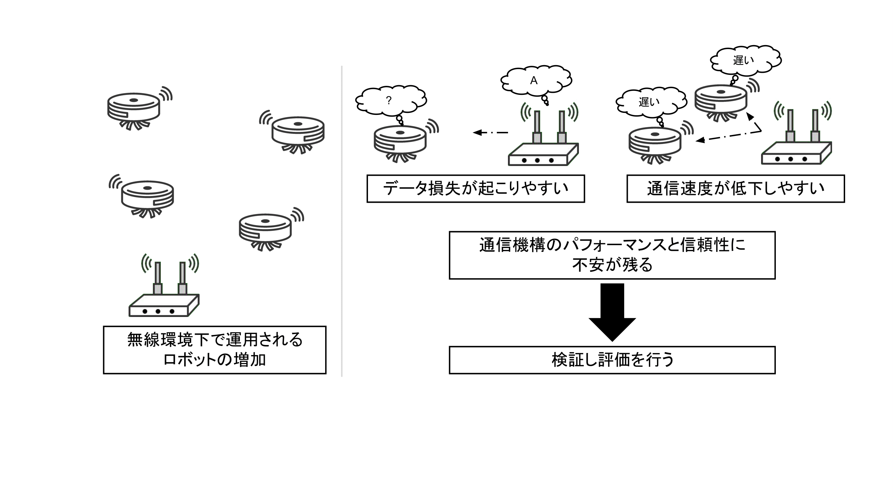

### 移動・外出を考慮したスマートリモコンのパーソナライズ機構

**木田 至音**  
情報システムコース・4 年

- 近年、家電の制御機能や、センシング機能を備えたスマートリモコンが普及しつつある。
- 家電の利用データから快適な状態を学習し、空間の快適性をはかる、空間のパーソナライズ化が進んでいる。
- 移動によって生じる様々な動的要因から、快適な空間は変化するため、パーソナライズ化された空間は移動先・外出先で利用できない。
- 各ユーザが定めるパーソナライズ化された値は一意に定まらない。
- コードが実行できるスマートリモコンを開発して持ち運び、コードを書き込むことで状況に応じた設定を行う。
- 移動・外出先でもパーソナライズ化された空間の実現

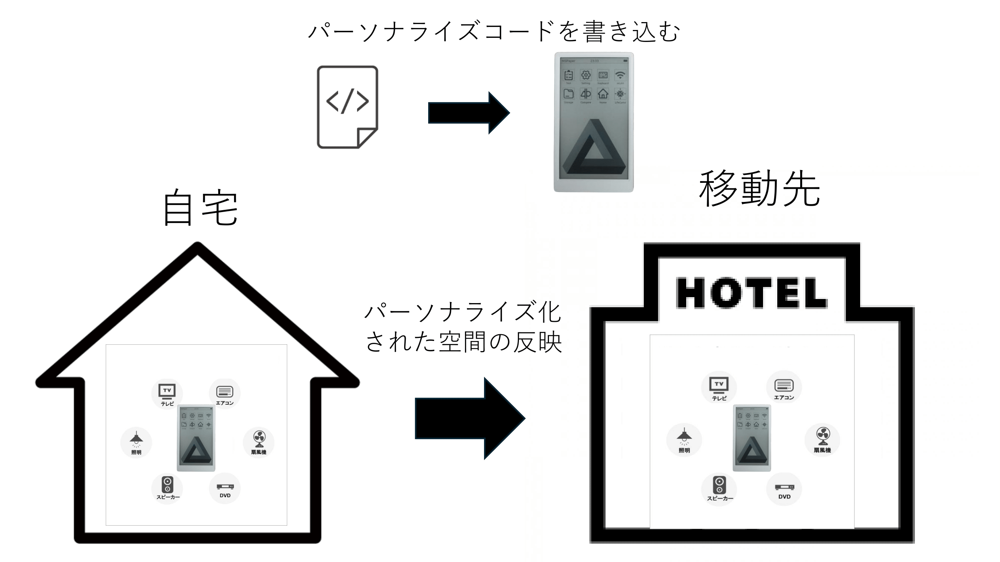

### VM型TEEエミュレーション機能の実現

**岩崎 誠也**  
情報システムコース・4 年

- クラウドコンピューティングには、クラウド事業者の不正やシステムの脆弱性を狙った第三者の攻撃による、データへの不正アクセスや情報漏えい、改ざんなどのリスクが存在
- クラウドにおけるデータの機密性を高める技術として、仮想マシンのメモリをハードウェアによって暗号化するVM型TEE (Trusted Execution Environment)である「機密VM」が注目
- 「機密VM」を提供する機能の代表例であるAMD SEV (Secure Encrypted Virtualization)の利用には、専用ハードウェア（プロセッサ）が必要であり、用意しない限り関連したソフトウェア開発やデバッグが困難
- AMD SEV機能をソフトウェア的に再現するエミュレータを作成することで、実際にハードウェアを用意しなくても開発・デバッグを行うことが可能になり「機密VM」の利用を促進
- 仮想化ソフトであるQEMU上でAMD SEV機能のエミュレートを実現

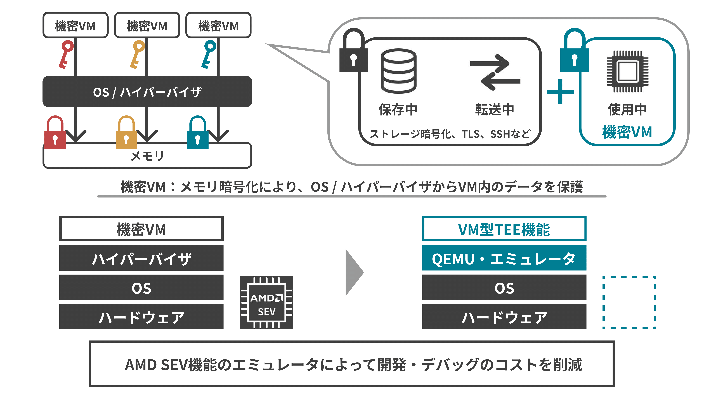

### 悪性USBデバイスを用いた物理的不正アクセスへの対処手法に関する研究 

**武藤 恵理也**  
情報システムコース・4 年

- キーボードとして認識し、不正なコマンドを自動実行する悪性USBデバイスの脅威
- 既存の対策は、管理者やユーザーへの負担が大きく、正規デバイスを装う攻撃にも対応が困難
- ハードウェア・OS間の通信を仲介するハイパーバイザを活用した新たな対策手法を提案
- USBデバイス接続時に認証を要求し、認証に成功したデバイスのみシステムとの通信を許可
- 軽量なハイパーバイザであるBitVisorを用いた提案手法の実装と有効性評価を計画

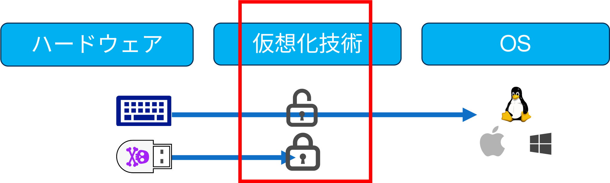

### 独自インターフェースを持つ未来大仮想マシンのIaC対応

**西 侑亮**  
情報システムコース・4 年

- 近年、仮想マシンを利用する事例が多い
- その仮想マシンをマウス移動やクリックを使わず、コードで管理手法がある
- その手法をInfurastructure as Codeという（IaC)
- 未来大の仮想マシン（アルゴなどの講義で使用）のIaC対応を目指す
- セキュリティや予算の関係上、仮想マシンを直接管理をするAPIは公開できない
- Webブラウザを全自動で操るスクレイピング技術を使って、未来大の仮想マシン管理画面( https://manage.p.fun.ac.jp/server_manage )を操作して仮想マシンを管理

[**過去の卒業研究・修士研究（発表論文へのリンク）**](https://researchmap.jp/ktymtbr/published_papers)

## 研究活動

### 設備

研究室では，学部 4 年生が利用する表部屋と，院生が利用する院生室と裏部屋の 3 つが提供されています．

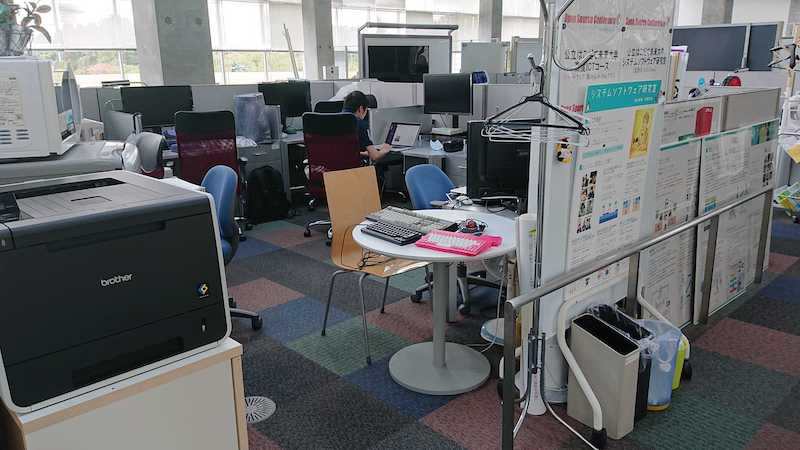

研究室には，高級キーボードや大型ディスプレイ，ドローンやロボットなどのデバイス，PC クラスタやサーバ PC など，こだわりの研究設備が揃っています．

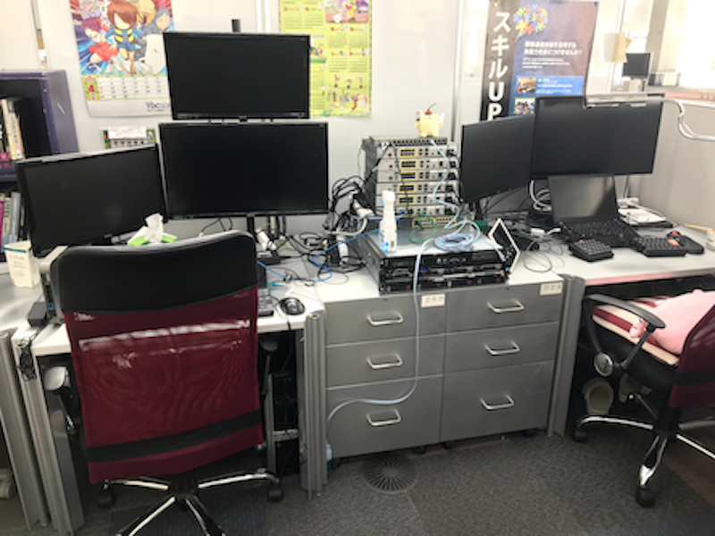

研究室内のメンバーだけでなく，楽しい後輩たちや他の研究室のメンバーともコミュニケーションを取りながら，楽しく研究できます．

### ゼミ

本研究室では，教員と学生の予定に合わせて進捗報告のゼミ 1 回，自分が読んだ論文の紹介をするゼミ 1 回，研究分野の近い者同士でのグループゼミ 1 回の合計 3 回を毎週行っています．

### 学会

研究やゼミを通して順調に成果を出すことで，学会やオープンソース系の会議（RubyKaigi，OSC，Open Source Summit など）に参加することができます．

研究が上手くいけば，海外に行けるかも！？

### イベント

本研究室では，研究以外にもメンバー内での交流を図るために，新歓，BBQ，飲みなどのイベントを開催しています．もちろん，お酒が苦手な人でも気軽に参加できるような雰囲気で楽しんでいます！

研究室内外に関わらず，本研究室に興味がある人も参加できるかも...？

## 問い合わせ先

## おわりに

当研究室にきて，圧倒的成長しよう！ 
低レイヤ沼が君を待っている！

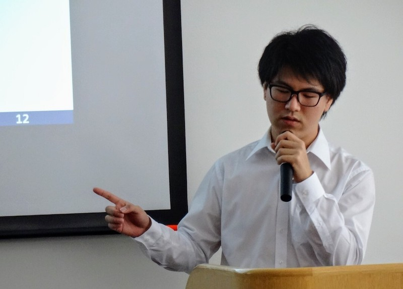

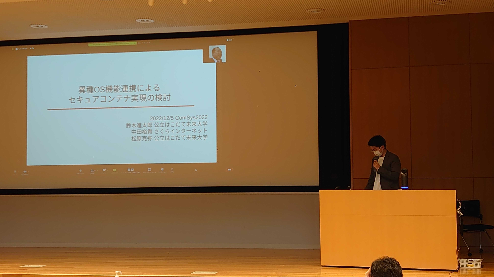

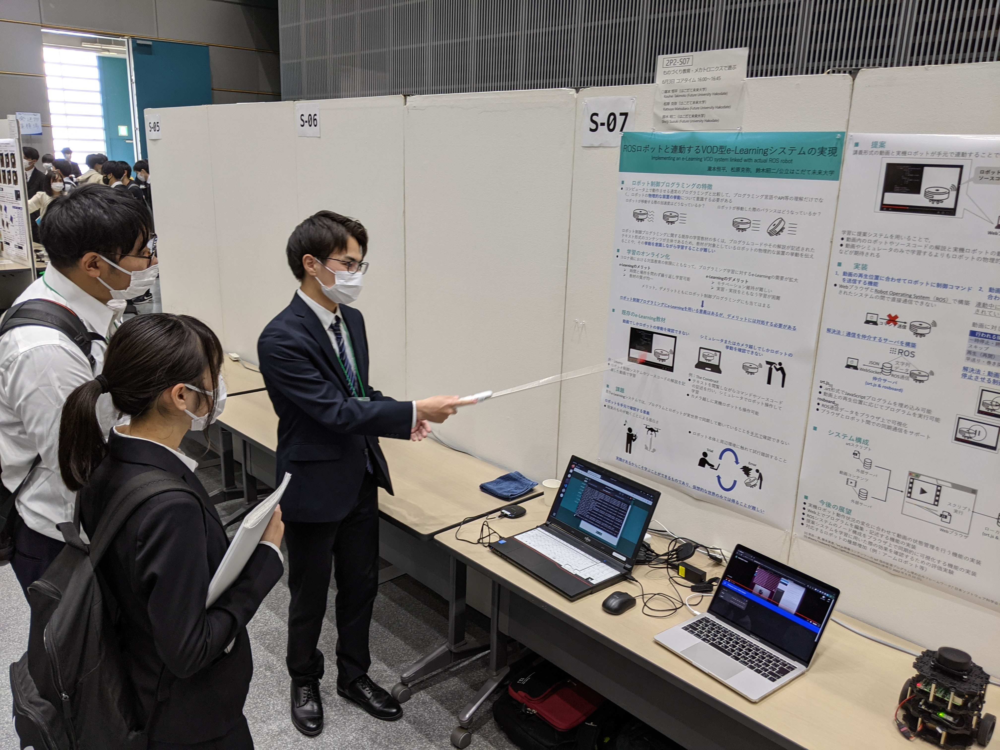

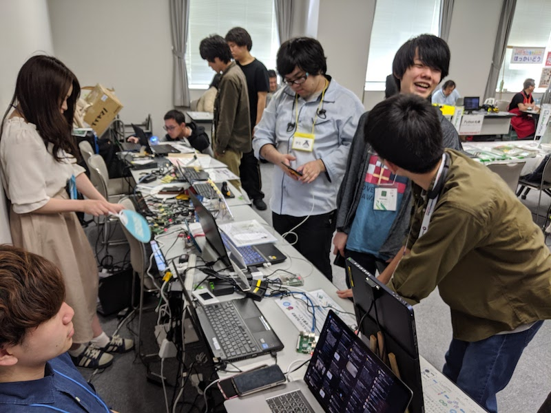

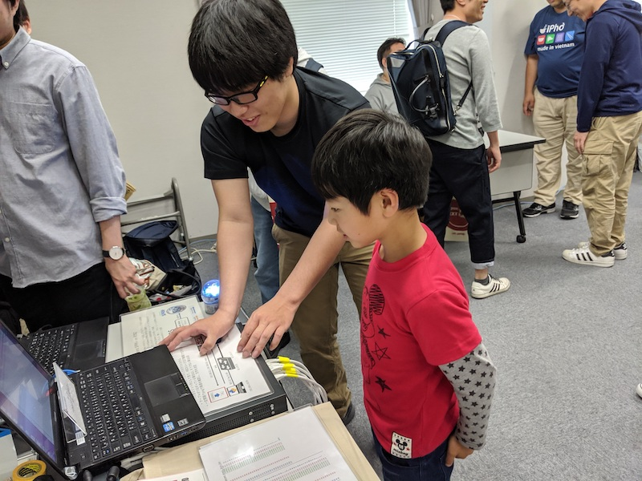

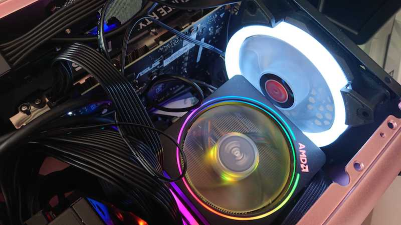

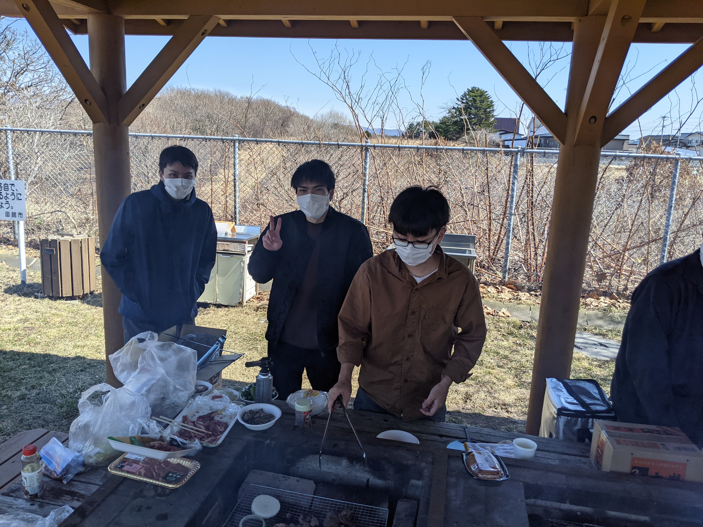

