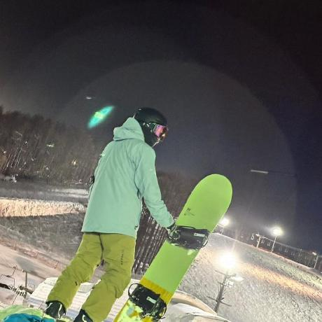
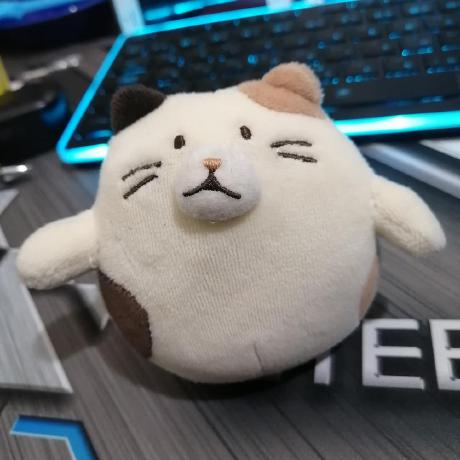
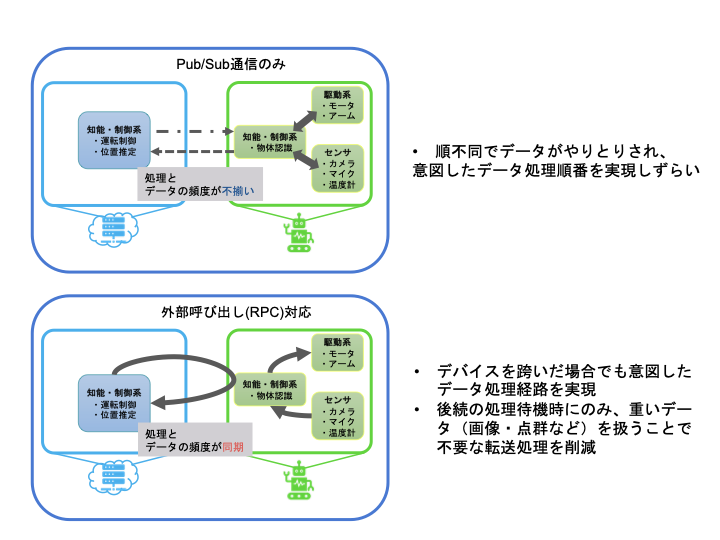
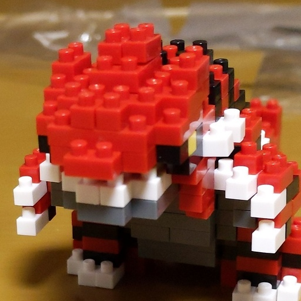
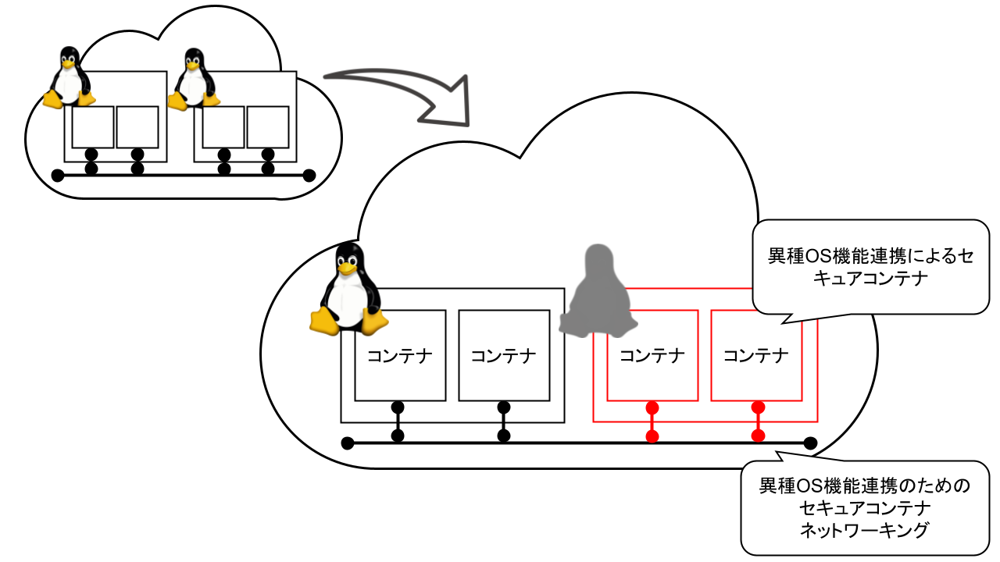
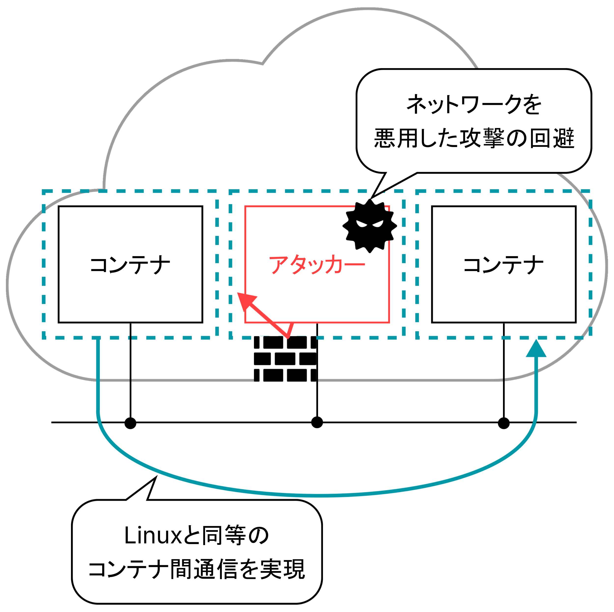
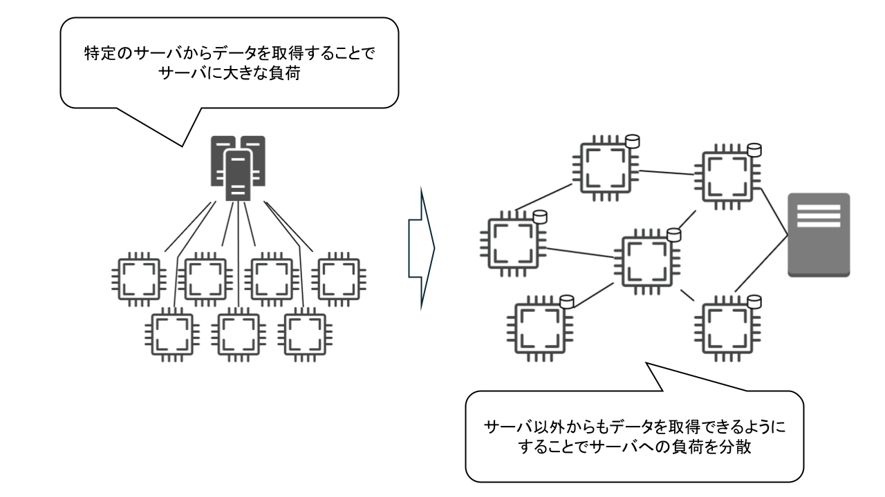
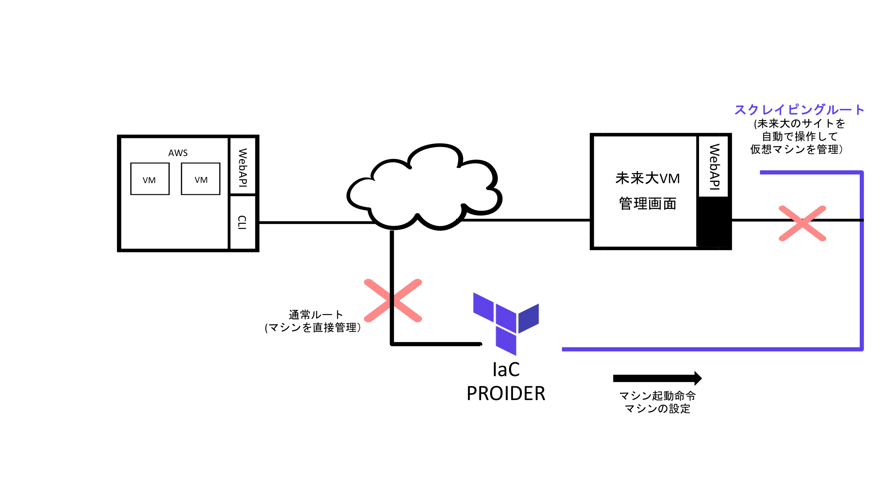
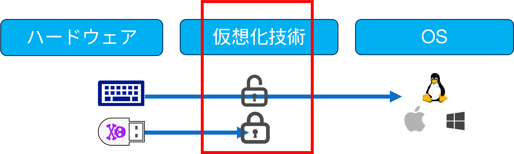
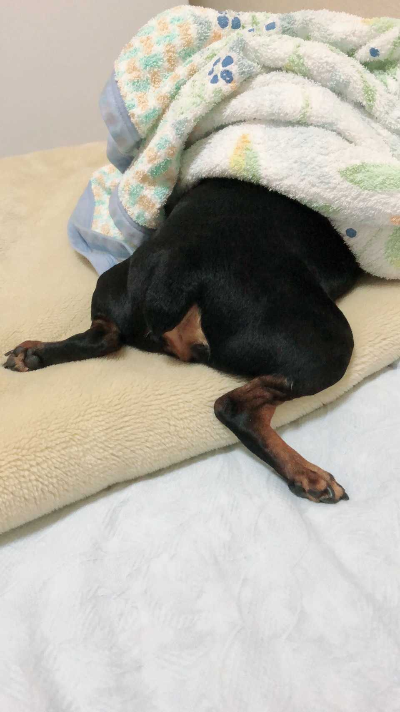

## 目次

- [研究室紹介出展概要](#研究室紹介出展概要)
- [システムソフトウェア研究](#システムソフトウェア研究)
- [研究紹介](#研究紹介)
- [研究活動](#研究活動)
- [問い合わせ先](#問い合わせ先)
- [おわりに](#おわりに)

## 研究室紹介出展概要

- オープンラボ当日は，対面にて，下記の催しを行います．
    - 異空間鉄道86-64
    - ROSFit Adventure
    - 堅（Kata）いコンテナ
    - IoTでIaT（イルミネーション as Terraform）
    - ちょいぐる

## システムソフトウェア研究

本研究室では，システムソフトウェアの研究をとおして，社会で**飛びぬけて活躍できる**エンジニアスキルを身につけることを目指しています．

### システムソフトウェアって何？

システムソフトウェアは，PC やスマホで動く様々なアプリケーションの快適な動作や安心・安全を支える**縁の下の力持ち的**なソフトウェアです．  
代表的なものとして，OS（オペレーティングシステム）があります．  
（例：Windows，Mac，Android，Linux など）

### システムソフトウェアがないとどうなるの？

例えばインターネット... OS がないと，複雑で難解なネットワーク通信を自分で制御しなければならず，ネットサーフィンするのも一苦労です．

例えば，アプリケーションを使うとき... Word や Excel，ゲームや Web ブラウザを同時に使えなかったり，フリーズしたり快適に動作しなかったりします．さらに，システム攻撃や情報漏えいに対して無防備になります．

### システムソフトウェアを研究して，いいことあるの？

#### いいことその１：**ブラックボックスの解明**

Windows や Mac，Android など，システム内の動作や仕組みを理解できるため，システムやアプリケーションのチューンナップ，エラー発生や動作不安定の原因究明に役立ちます．

#### いいことその 2：**最新技術研究とのコラボ**

IoT（Internet of Things）やビッグデータ，クラウドコンピューティングといった最新技術に触れることができます．

#### いいことその 3：**PC やスマホの眠れる力を呼び覚ます**

PC やスマホの性能を引き出し，新たな機能を創造できます．

### こんな人にオススメ

- コンピュータやプログラムが動いている裏側を知りたい！
- 低レイヤに関する技術力を高めたい！
- 松原克弥先生が好き！

#### キーワード

- システムソフトウェア技術（仮想化，ネットワーク，システムプログラミング，並列分散処理など）
- コンピューティング技術（クラウド，IoT など）
- 圧倒的成長
- 松原克弥

## 研究紹介

### 異種計算機群の有機的連携を可能にする超分散コンピューティング基盤

**中田 裕貴**  
博士 1 年

**藤井 大悟**  
高度ICT領域・修士 1 年

**齊藤 優月**  
情報アーキテクチャ領域・修士 1 年

**酒井 佑馬**  
複雑系コース・4 年

- デバイス・ユーザ近傍のエッジサーバ・大規模なデータセンタを活用したクラウドの有機的連携によってIoTやAIなどの大規模なデータを高速に処理
    - 有機的連携: 周辺環境などの状況変化や処理要件に合わせて、アプリケーションを構成する各計算モジュール群が実行場所を動的に変化させながら分散処理を最適化
- 多様な計算機間での実行ソフトウェアの動的再配置には、多くの技術的課題が存在
    - Kubernetesのような分散処理管理システムには、各計算モジュールをどこの計算機へ配置するかを決める機能があるが、デバイス・エッジ・クラウドなどの異なる特性をもつ計算機階層を有効的に活用できない
    - デバイス、エッジ、クラウドのハードウェアやOSが異なるため、計算モジュール実行先の柔軟な選択を可能にするには、多様な計算機環境に対応するソフトウェア実行基盤とその実行モジュールを動的に再配置できる機構が必要
- WebAssemblyとライブマイグレーションを組み合わせによってこれらの課題を解決
    - WebAssembly：あらゆる計算機環境でプログラムを実行可能な仮想マシンであり、 デバイスやエッジ、クラウド環境それぞれに特化したランタイムが存在
    - ライブマイグレーション：実行中のソフトウェアと処理状態を別の計算機環境に移動・再配置し処理を継続する技術
    - 各環境に最適なWebAssemblyランタイムでソフトウェア実行し、ランタイム間でのライブマイグレーションとKubernetesによる制御を可能にすることで、クラウド-エッジ-デバイス間で柔軟なアプリケーション動的再配置を実現

### mROS 2/WasmにおけるRPC型ノード間通信機能の実現

**石本 直也**  
情報アーキテクチャ領域・修士 2 年

- ロボットとクラウドが連携することで、高度な知能処理と低遅延な制御処理を両立できるクラウドロボティクスの採用が拡大
- アーキテクチャ中立なWebAssemblyを活用する mROS 2/Wasm では、ロボットシステムを構成する各ROSノードをクラウドとロボットの間で柔軟に配置することが可能
- ロボットシステムにROSを採用する最大のメリットのひとつに、再利用が容易な機能モジュール実装が多数存在することがある
- Google Catographerなどの、既存ROSモジュール実装の多くは、現在のmROS 2/Wasmが対応するPub/Sub型通信だけでなく、同期的なターンアラウンド通信であるPRC型通信を用いている
- ROS 2と互換性のあるRPC型通信機能を実現することで、より多くの既存ROS機能モジュールをmROS 2/Wasmで活用できるようにすることを目指す

### 無線通信を想定したロボット制御ミドルウェア ROS 2 の通信機構に関する評価

**川平 覚士**  
知能システムコース・4 年

- クラウドとロボット間、複数のロボット間の連携において、Wi-Fiなどの無線通信を用いるロボットシステムが増加
- ROS 2 (Robot Operating System 2) の機能モジュール間通信の実現に採用されているUDPマルチキャストは、無線通信では非効率な実現となってしまうことが知られている
- 本研究では、microROSを稼働させた小型デバイス群を用いて、無線通信環境下におけるROS 2機能モジュール間通信を実測評価

### 異種OS機能連携によるセキュアコンテナ

**鈴木 進太郎**  
情報アーキテクチャ領域・修士 2 年

**坂口 颯麻**  
情報アーキテクチャ領域・修士 1 年

- マイクロサービス・アーキテクチャなどのクラウドネイティブなシステム構築の普及にともなって、クラウド基盤におけるコンテナ型仮想化の活用が拡大
- Linux上で実現されコンテナは、Linuxカーネルをコンテナ間で共有するため、カーネル脆弱性を悪用した攻撃に対して脆弱であるというリスクが存在
- ハードウェア仮想化の併用（Kata）やシステムコール検査（gVisor）などの既存対策では、コンテナの最大の特性のひとつである「高速な起動と軽量な実行」に対する影響が甚大
- 本研究では、Linux以外のOSカーネル上でLinuxコンテナを互換実行することで、Linuxカーネルの脆弱性に対する攻撃を低オーバヘッドに回避できる仕組みを実現
- さらに、異種OSが持つ独自のセキュリティ機能をコンテナへ透過的適用することで、ライブラリやアプリケーションの脆弱性に対する攻撃へも対処
- Linuxコンテナ間通信機構との互換性を維持しつつ、異種OS上でセキュアなコンテナ間通信を確立できるコンテナネットワーキング機能を実現

### VM型TEEエミュレーション機能の実現

**岩崎 誠也**  
知能システムコース・4 年

- クラウドコンピューティングには、クラウド事業者の不正やシステムの脆弱性を狙った第三者の攻撃による、データへの不正アクセスや情報漏えい、改ざんなどのリスクが存在
- クラウドにおけるデータの機密性を高める技術として、仮想マシンのメモリをハードウェアによって暗号化するVM型TEE (Trusted Execution Environment)である「機密VM」に注目
- 「機密VM」を実現するハードウェア機能であるAMD SEV (Secure Encrypted Virtualization)を用いたシステムの開発には、SEVが実装された希少かつ高価な専用プロセッサが必要であり、また、ハードウェア機能を活用するソフトウェア開発には高難度なデバッグがともなう
- AMD SEV機能をソフトウェア的に再現するエミュレータを作成することで、実際にハードウェアを用意しなくても開発・デバッグを行うことが可能になり「機密VM」の利用を促進
- 仮想化ソフトであるQEMUへAMD SEVのエミュレーション機能を実装

### IoTデバイス群を対象としたP2P型ネットワークブート機構の最適化

**伊藤 晋梧**  
高度ICT領域・修士 2 年

- IoTデバイスは、ネットワークに常に繋がっているためセキュリティ対策などの適切な管理が必要である
- 一方で、IoTデバイスは、広域に分散して配置されている場合があるため管理が煩雑である。
- 遠隔に位置するサーバからOSイメージを取得しマシンを起動するネットワークブートを用いることで、デバイスを効率的に管理できる
- ネットワークブートにおける、大量のデバイスを一斉に起動した際に起動時間が増加するブートストームに対して、OSイメージの分散管理を導入することで、ブートストームの軽減を目指した
- 実装したネットワークブートシステムと、従来のネットワークブートシステムの起動時間を比較した結果、ブートストームの軽減はわずかに見られたが、従来のネットワークブートよりも起動時間が大幅に増大した
- 本研究では、実装したシステムのボトルネックとなるところを明らかにし、改善、評価する

### 独自インターフェースを持つ未来大仮想マシンのIaC対応

**西 侑亮**  
情報システムコース・4 年

- はこだて未来大をはじめ、多くの大学で教育用計算機環境へのクラウド導入が加速
- パブリッククラウドを採用する場合でも、授業や教育システムに特化するために、管理インタフェースをカスタマイズすることが多い
- 一方、管理インタフェースが異なることで、パブリッククラウドにおいて広く活用されている既存の管理集約化・効率化手法が適用できない
- 管理集約化・効率化手法のひとつに、高水準の構成プログラミング言語によるコードで仮想マシンの管理を可能にする Infrastructure as Code (IaC)というフレームワークがあり、その実装のひとつに Terraform が知られている
- 本研究では、Terraformを使って未来大の仮想マシンを管理できるようにすることで、特定授業向けにカスタムした仮想マシンの一斉設定や、複数仮想マシンの同時制御などをプログラムコード配布により実現できるシステムを実現

### 悪性USBデバイスを用いた物理的不正アクセスへの対処手法に関する研究 

**武藤 恵理也**  
情報システムコース・4 年

- キーボードとして認識し、不正なコマンドを自動実行する悪性USBデバイスの脅威
- 既存の対策は、管理者やユーザーへの負担が大きく、正規デバイスを装う攻撃にも対応が困難
- ハードウェア・OS間の通信を仲介するハイパーバイザを活用した新たな対策手法を提案
- USBデバイス接続時に認証を要求し、認証に成功したデバイスのみシステムとの通信を許可
- 軽量なハイパーバイザであるBitVisorを用いた提案手法の実装と有効性評価を計画

### Wasmマイグレーションを活用した移動先スマートリモコンの動的パーソナライズ化

**木田 至音**  
情報システムコース・4 年

- 複数家電の制御や環境センシングなどの機能を備えたスマートリモコンが登場
- 家電やリモコンの高機能化・高性能化にともなって、利用データから快適な状態を学習して、個々人に合わせた最適な居住空間を調整できる家電制御のパーソナライズ化に期待があつまっている
- 温度設定値などの静的なデータだけでは、環境変化や対象ユーザの状況に応じた柔軟な調整が難しい
- 特定の居室にある家電リモコンのパーソナライズ化だけでは、居室間移動や外出先などに対応できない
- メモリ容量などに制約のあるリモコンでは、複数の利用者向けのパーソナライズデータをすべて保持することは難しい
- 本研究では、個々人に合わせた家電制御をプログラムコードで記述できるようにし、マイグレーション機能を実現したWasmランタイム上でそのコードを実行できるシステムを実現
- ユーザの移動や外出に合わせて、パーソナライズ化された制御プログラムが移動先リモコンへ移動することで、移動先の状況とユーザの嗜好に合わせた家電制御の自動化を可能にする

### 空港手荷物受取所向け拡張現実型情報提示システムの社会実装

**中村 碧**  
情報アーキテクチャ領域・修士 1 年

- 手荷物を機内へ持ち込む旅客の増加により収納時間が増大し遅延率が増加している。手荷物を預けることが忌避される要因は、荷物がいつ来るか分からない中待機を強制されることで発生
- 手荷物受取所のベルトコンベアを利用した「回転すし」スタイルのグルメ情報閲覧サービスのテストリリースが実現
- テストリリースの評価では、インストール率3%でサービス利用者が少ない、コンテンツ量が少ないためサービス利用時間が短いという評価
- サービスを利用するためにインストールを必要とする実装が、サービス利用までのハードルになっている。また、グルメコンテンツ作成のプロセスは、多くの時間を要するため大量にコンテンツ作成が難しい
- Webアプリケーション化とグルメコンテンツ作成の半自動化を行うことでテストリリースの問題点を解決し、ちょいぐるの社会実装を目指す

[**過去の卒業研究・修士研究（発表論文へのリンク）**](https://researchmap.jp/ktymtbr/published_papers)

## 研究活動

### 設備

研究室では，学部 4 年生が利用する表部屋と，院生が利用する院生室と裏部屋の 3 つが提供されています．

研究室には，高級キーボードや大型ディスプレイ，ドローンやロボットなどのデバイス，PC クラスタやサーバ PC など，こだわりの研究設備が揃っています．

研究室内のメンバーだけでなく，楽しい後輩たちや他の研究室のメンバーともコミュニケーションを取りながら，楽しく研究できます．

### ゼミ

本研究室では，教員と学生の予定に合わせて進捗報告のゼミ 1 回，自分が読んだ論文の紹介をするゼミ 1 回，研究分野の近い者同士でのグループゼミ 1 回の合計 3 回を毎週行っています．

### 学会

研究やゼミを通して順調に成果を出すことで，学会やオープンソース系の会議（RubyKaigi，OSC，Open Source Summit など）に参加することができます．

研究が上手くいけば，海外に行けるかも！？

### イベント

本研究室では，研究以外にもメンバー内での交流を図るために，新歓，BBQ，飲みなどのイベントを開催しています．もちろん，お酒が苦手な人でも気軽に参加できるような雰囲気で楽しんでいます！

研究室内外に関わらず，本研究室に興味がある人も参加できるかも...？

## 問い合わせ先

## おわりに

当研究室にきて，圧倒的成長しよう！ 
低レイヤ沼が君を待っている！

