

## 目次

- [研究室紹介出展概要](#研究室紹介出展概要)
- [システムソフトウェア研究](#システムソフトウェア研究)
- [研究紹介](#研究紹介)
- [研究活動](#研究活動)
- [問い合わせ先](#問い合わせ先)
- [おわりに](#おわりに)

## 研究室紹介出展概要

- オープンラボ当日は，対面にて，下記の催しを行います．
  - ちょいぐる
  - ラインでGO！！
  - 異空間鉄道 86-64
  - OSなニブイチ 〜BSDからの挑戦状〜
  - わらしべBoot

## システムソフトウェア研究

本研究室では，システムソフトウェアの研究をとおして，社会で**飛びぬけて活躍できる**エンジニアスキルを身につけることを目指しています．

### システムソフトウェアって何？

システムソフトウェアは，PC やスマホで動く様々なアプリケーションの快適な動作や安心・安全を支える**縁の下の力持ち的**なソフトウェアです．  
代表的なものとして，OS（オペレーティングシステム）があります．  
（例：Windows，Mac，Android，Linux など）

### システムソフトウェアがないとどうなるの？

例えばインターネット... OS がないと，複雑で難解なネットワーク通信を自分で制御しなければならず，ネットサーフィンするのも一苦労です．

例えば，アプリケーションを使うとき... Word や Excel，ゲームや Web ブラウザを同時に使えなかったり，フリーズしたり快適に動作しなかったりします．さらに，システム攻撃や情報漏えいに対して無防備になります．

### システムソフトウェアを研究して，いいことあるの？

#### いいことその１：**ブラックボックスの解明**

Windows や Mac，Android など，システム内の動作や仕組みを理解できるため，システムやアプリケーションのチューンナップ，エラー発生や動作不安定の原因究明に役立ちます．

#### いいことその 2：**最新技術研究とのコラボ**

IoT（Internet of Things）やビッグデータ，クラウドコンピューティングといった最新技術に触れることができます．

#### いいことその 3：**PC やスマホの眠れる力を呼び覚ます**

PC やスマホの性能を引き出し，新たな機能を創造できます．

### こんな人にオススメ

- コンピュータやプログラムが動いている裏側を知りたい！
- 低レイヤに関する技術力を高めたい！
- 松原克弥先生が好き！

#### キーワード

- システムソフトウェア技術（仮想化，ネットワーク，システムプログラミング，並列分散処理など）
- コンピューティング技術（クラウド，IoT など）
- 圧倒的成長
- 松原克弥

## 研究紹介

### ランタイム中立なWebAssemblyライブマイグレーションの実現

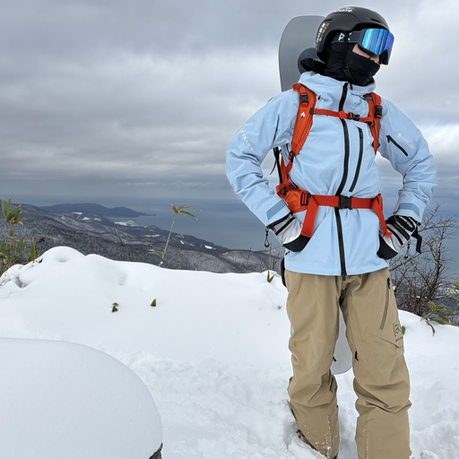

**中田 裕貴**  
博士 2 年

**藤井 大悟**  
高度ICT領域・修士 2 年

- 近年、大規模なクラウドから軽量なエッジデバイスまで、異なる特徴をもつ計算環境で構成されるエッジコンピューティングが注目
- クラウドの高い計算性能とエッジの低遅延を組み合わせ、高性能と低遅延を両立できる柔軟な処理が可能
- WebAssembly (Wasm) はプラットフォーム中立で軽量なため、こうした異種環境で動作する汎用的な実行基盤に適する
- Wasmランタイムも軽量性・高速性・多機能性など異なる特徴をもち、環境ごとに最適なランタイムが変わる
- 本研究では、計算環境とランタイムの多様性を動的に活用するランタイム中立なWasmマイグレーションを提案し、アプリケーションが状況に応じて最適なノードやランタイムを選び、異種環境の利点を最大限に引き出せることを目指す

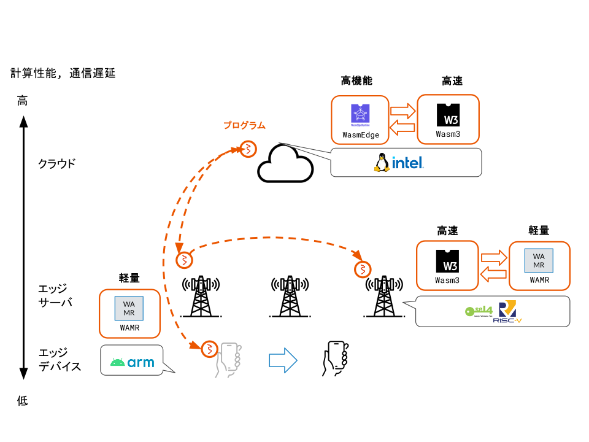

### WebAssemblyマイグレーションを活用した異種クラウド編成機能

**齊藤 優月**  
情報アーキテクチャ領域・修士 2 年

- 異種ランタイム間WebAssembly(Wasm)マイグレーションを活用し、状況に応じてノードやWasmランタイムを切り替えることで、エッジコンピューティングを活用可能
- アプリケーションはコンテナでの実行が主流であり、コンテナの配置場所決定や停止時の回復など、一括管理が可能なコンテナオーケストレータを用いることが多い
- 既存のオーケストレータでは、エッジコンピューティングの特性を考慮した配置ができず、回復時は初期状態のコンテナを再起動するためマイグレーションもできない
- また、実行中のコンテナを停止しようとはしないため、システム状況に応じた動的な実行ノードの移行や、Wasmランタイムの切り替えができない
- Wasmをコンテナとして実行し、停止時には実行状態を記録、再起動時に復元する処理を追加することで、オーケストレータによるコンテナ回復時にマイグレーションを実現
- メモリ使用量などシステム状況に応じて、コンテナを停止し、起動ランタイムを変更して起動する処理を実装することで、適したノードとWasmランタイムへの動的な移行を実現

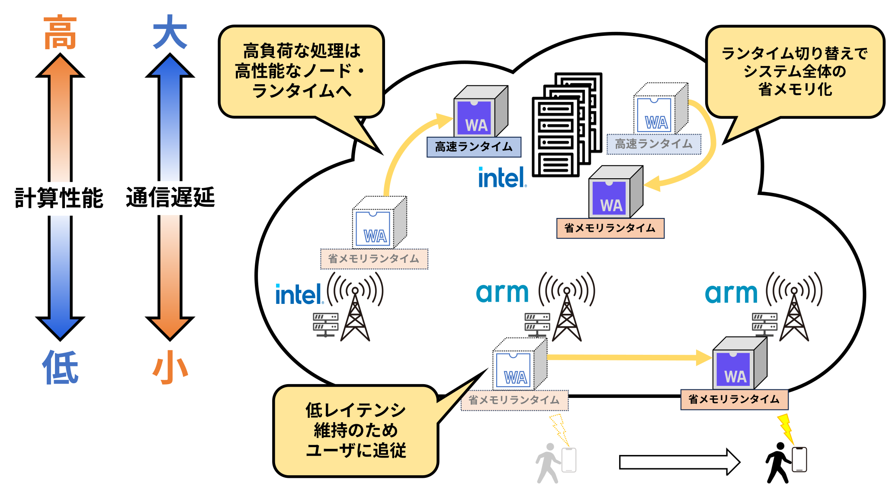

### 異種OS機能連携のためのセキュアコンテナ・ネットワーキング

**坂口 颯麻**  
情報アーキテクチャ領域・修士 2 年

- マイクロサービス・アーキテクチャなどのクラウドネイティブなシステム構築において、頻繁なコンテナ間通信を介する処理によって全体のサービスを構成する特徴から、コンテナネットワーキングは必要不可欠
- 一方で、頻繁なコンテナ関通信を悪用したコンテナネットワーキングに対する攻撃への対処も必要
- ほとんどのコンテナネットワーキングはLinuxに依存した実装であり、異種OS機能連携によるセキュアコンテナ環境では利用不可
- コンテナネットワーキングの一般的なアプローチであるContainer Networking Interface（CNI）を異種OS環境へ移植することで、Linuxと同等のコンテナネットワーキングを実現
- 細粒度なネットワーク隔離を施すことで、コンテナ間通信を悪用した攻撃へ対処し、異種OS機能連携によるセキュアコンテナの堅牢さを維持

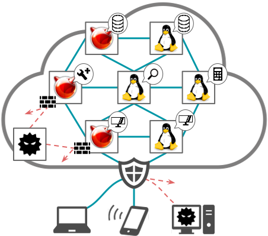

### 異種OS機能連携によるセキュアコンテナを対象とした安全なシステムコール代理実行機構

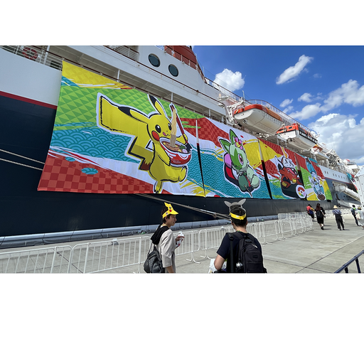

**坂本 光太郎**  
高度ICTコース・4 年

- マイクロサービス・アーキテクチャなどのクラウドネイティブなシステム構築の普及にともなって、クラウド基盤におけるコンテナ型仮想化の活用が拡大
- Linux上で実現されたコンテナは、Linuxカーネルをコンテナ間で共有するため、カーネル脆弱性を悪用した攻撃に対して脆弱であるというリスクが存在
- Linux以外のOSカーネル上でLinuxコンテナを互換実行することで、Linuxカーネル脆弱性に対する攻撃を低オーバヘッドに回避可能
- 加えて、異種OS固有のセキュリティ機構をコンテナへ透過的適用することで、ライブラリやアプリケーションの脆弱性に対する攻撃へも対処可能
- しかし、セキュリティ機構によってシステムコールが制限されるため、コンテナ内アプリケーションの正常実行が困難
- 本研究では、Linux互換コンテナへシステムコール代理実行機構を適用することで、異種OS機能連携によるセキュアコンテナのもつ軽量さと安全性を最大限維持しつつ、アプリケーション互換性の向上を実現

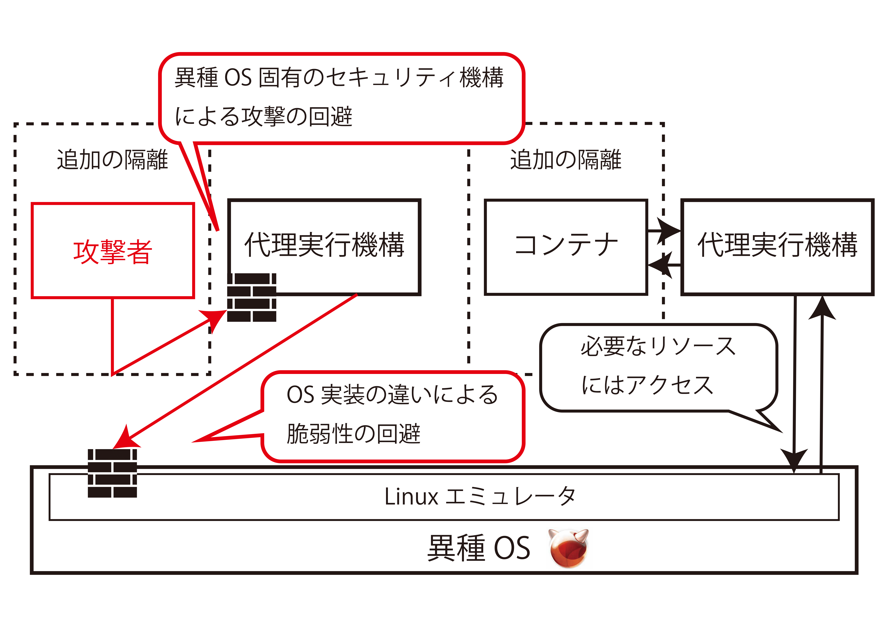

### ロボット機能モジュールを対象としたアーキテクチャ中立な動的マイグレーション機構

**梶村 拓斗**  
高度ICTコース・4 年

- クラウドコンピューティングの発展によりロボット制御処理をクラウドとロボットで分担するクラウドロボティクスが普及している
- ロボットソフトウェア開発用フレームワークとして広く使われるRobot Operating System(ROS)は，各機能モジュールをノードとして実装し，ネットワークを介して分散配置することが可能で，クラウドロボティクスにも応用されている
- しかし現状のROSではノードの配置を決定してしまうと，変更が難しいため環境変化に対応しづらい
- 本研究では異なるデバイス間でROSノードを動的にマイグレーションする機構を提案する
- ロボットとクラウドでは主に用いられるCPUアーキテクチャが異なり実行状態に互換性がないという課題にはWebAssemblyを用いることで対処する
- ROSノードの動的マイグレーションにより環境変化に合わせた柔軟なノード配置を実現することが可能になる

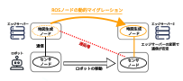

### クラウドロボティクス向け通信プロトコル実装に関する研究

**松原 僚亮**  
情報システムコース・4 年

- ロボットとクラウド間で機能の役割を分担・連携し, 高度な知能・制御処理を可能にするクラウドロボティクスが普及
- ロボット開発の標準にROS 2が用いられるが、通信基盤であるDDSには無線通信環境下での通信や大規模データの通信に課題が存在
- 既存課題を解決する新世代プロトコルとして、軽量かつマイコンにも対応する「Zenoh」が注目
- ROS 2の通信基盤をDDSからZenohに変更し、ロボット連携システムを用いたZenohの実測評価を行う

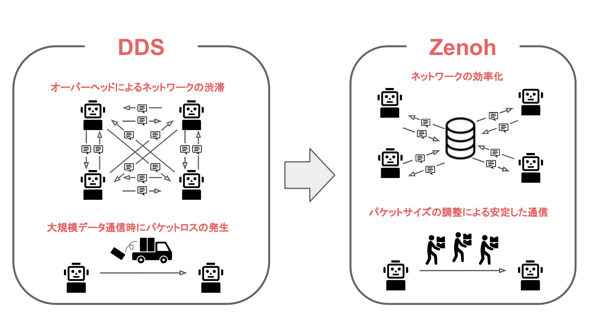

### 分散協調OSプロビジョニング実現に向けたP2P型ディスクキャッシュ共有機構

**岩崎 誠也**  
情報アーキテクチャ領域・修士 1 年

- IoTデバイスは、常にネットワークに接続しているため、セキュリティ対策などの適切な管理が必要
- 一方、IoTデバイスは管理対象となるデバイスの数が膨大なことや、広域に分散して配置されていることから管理が煩雑
- 遠隔に位置するサーバからOSイメージを取得してマシンを起動するネットワークブートを用いることで、デバイスを効率的に管理
- ネットワークブートにおいて、大量のデバイスを一斉に起動した際に起動時間が増加するブートストームに対して、OSイメージの分散管理を導入することで対処
- 本研究では、OSイメージの分散管理に、Linuxにおける主要なディスクキャッシュであるページキャッシュを利用することで、メモリ消費量の削減を実現

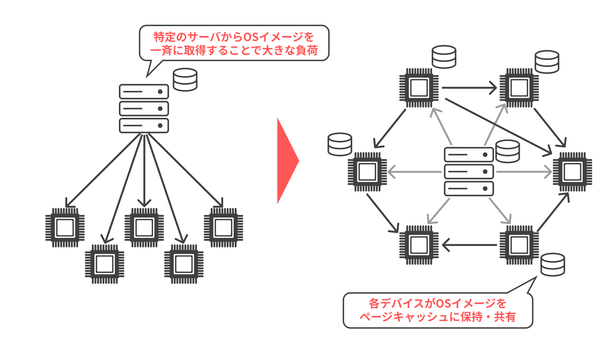

### 空港手荷物受空港手荷物受取所向け拡張現実型情報提示システムの社会実装

**中村 碧**  
情報アーキテクチャ領域・修士 2 年

- 手荷物を機内へ持ち込む旅客の増加により収納時間が増大し遅延率が増加している。手荷物を預けることが忌避される要因は、荷物がいつ来るか分からない中待機を強制されることで発生
- 手荷物受取所のベルトコンベアを利用した「回転すし」スタイルのグルメ情報閲覧サービスのテストリリースが実現
- テストリリースの評価では、サービス利用者が少なく、コンテンツ量の不足によるサービス利用時間の低下により、既存の成果では、社会において継続的に利用される成果ではないことが明らかになった
- 社会実装の実現には、非リピーター(観光客)が利用しやすいこと、専門技術がなくてもコンテンツを作成できること、コンテンツの多様性と豊富さを担保のために簡単にコンテンツを登録・更新する要件の達成が必須
- 社会実装達成の技術的チャレンジとして、Webアプリケーション化とグルメコンテンツ作成の半自動化、コンテンツ管理バックエンドの構築を行うことでちょいぐるの社会実装を実現する

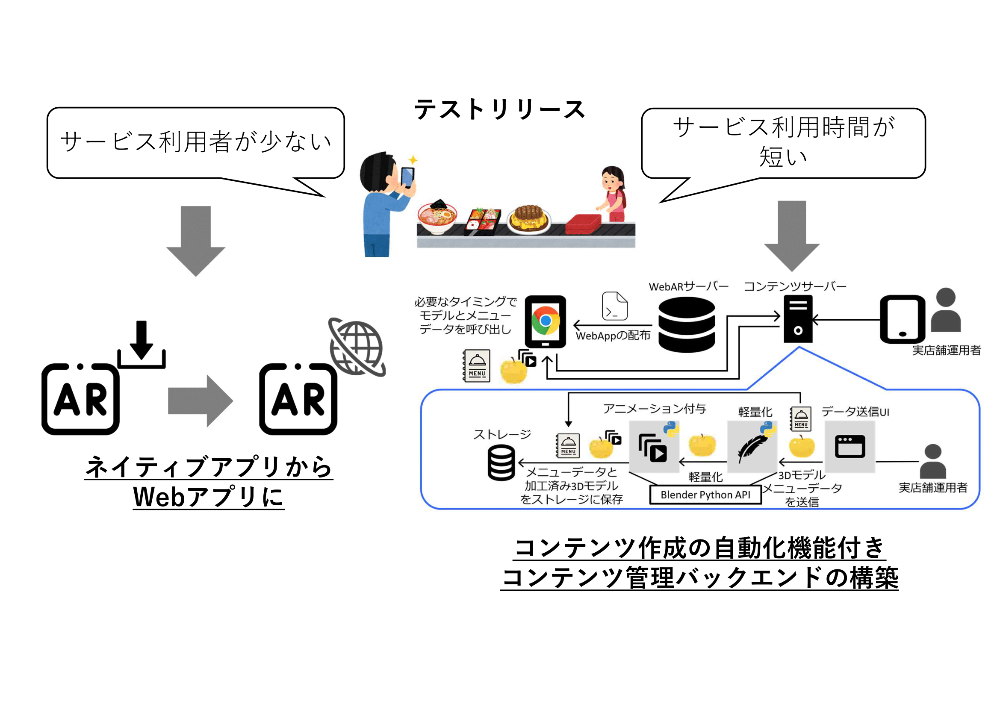

### 眺望体験の向上を目的とした拡張現実感技術による景観案内の実現

**高橋 健太**  
知能システムコース・4 年

- 訪日観光客や日本人国内旅行消費額の増加に伴い、日本における観光業の重要性が増加
- 山や展望タワーからの眺望は、観光の重要な目的の一つであり、このような高所に設置された鳥観図などの景観案内は、遠方にある観光地の名称やその概要を効率良く知ることが可能
- AR で景観案内アプリケーション実装する際、既存の AR 技術では位置精度における課題や、大量のデータを必要とする点で、実現が難しい
- 本研究では、既存の AR 技術の位置精度における課題と、大量のデータを必要とする課題を解決したアプリケーションの実現を目指す

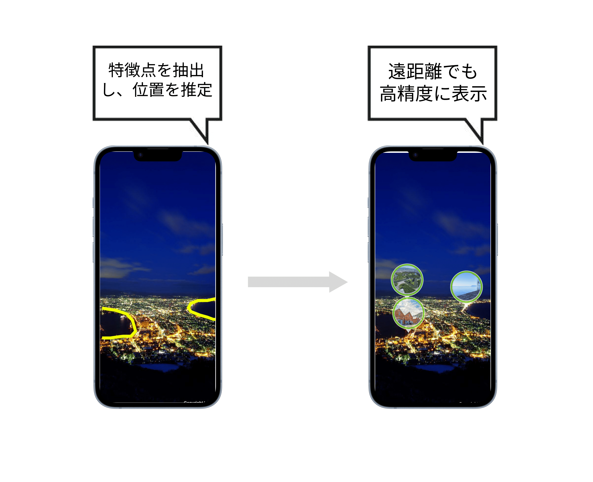

[**過去の卒業研究・修士研究（発表論文へのリンク）**](https://researchmap.jp/ktymtbr/published_papers)

## 研究活動

### 設備

研究室では，学部 4 年生が利用する表部屋と，院生が利用する院生室と裏部屋の 3 つが提供されています．

研究室には，高級キーボードや大型ディスプレイ，ドローンやロボットなどのデバイス，PC クラスタやサーバ PC など，こだわりの研究設備が揃っています．

研究室内のメンバーだけでなく，楽しい後輩たちや他の研究室のメンバーともコミュニケーションを取りながら，楽しく研究できます．

### ゼミ

本研究室では，教員と学生の予定に合わせて進捗報告のゼミ 1 回，自分が読んだ論文の紹介をするゼミ 1 回，研究分野の近い者同士でのグループゼミ 1 回の合計 3 回を毎週行っています．

### 学会

研究やゼミを通して順調に成果を出すことで，学会やオープンソース系の会議（RubyKaigi，OSC，Open Source Summit など）に参加することができます．

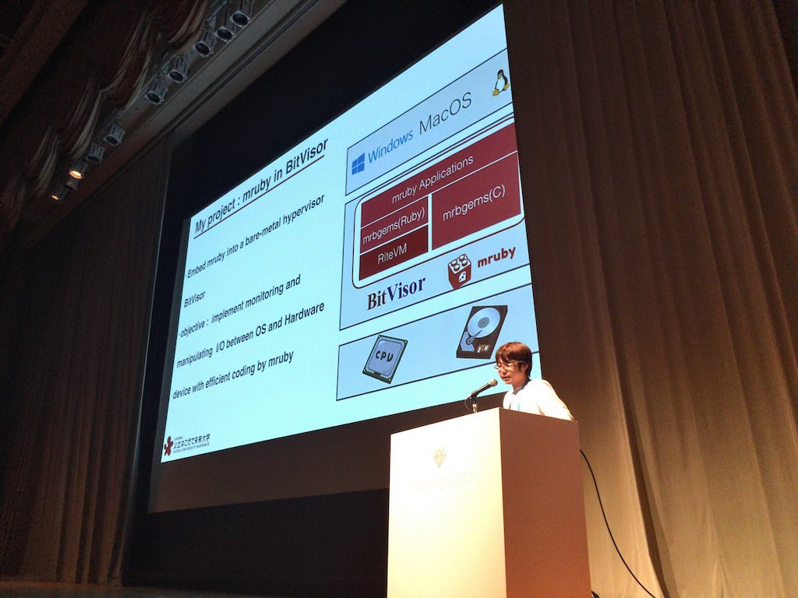

研究が上手くいけば，海外に行けるかも！？

### イベント

本研究室では，研究以外にもメンバー内での交流を図るために，新歓，BBQ，飲みなどのイベントを開催しています．もちろん，お酒が苦手な人でも気軽に参加できるような雰囲気で楽しんでいます！

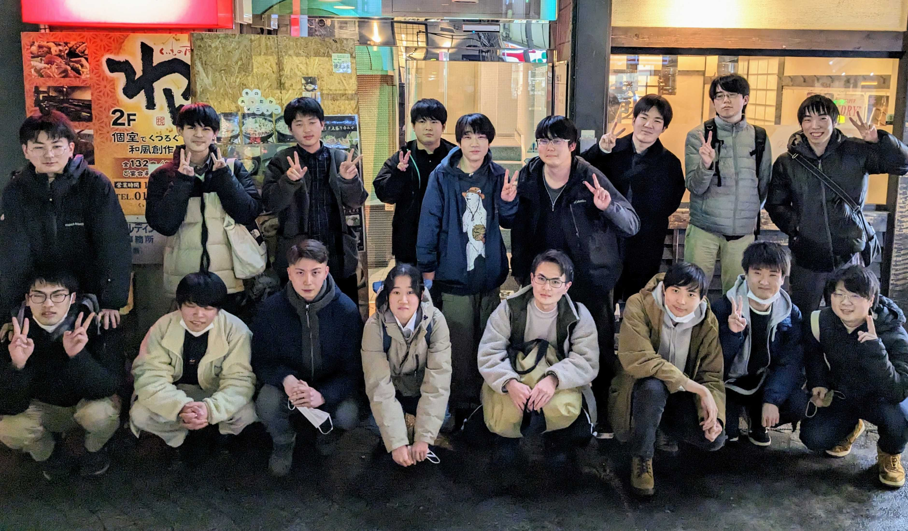

研究室内外に関わらず，本研究室に興味がある人も参加できるかも...？

## 問い合わせ先

## おわりに

当研究室にきて，圧倒的成長しよう！ 
低レイヤ沼が君を待っている！

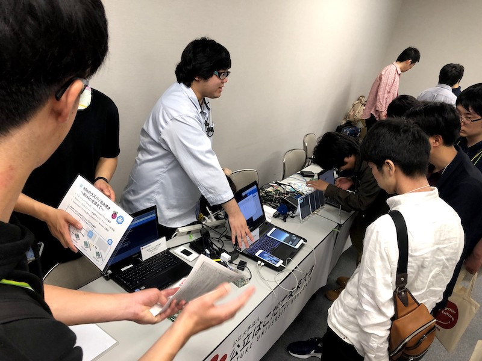

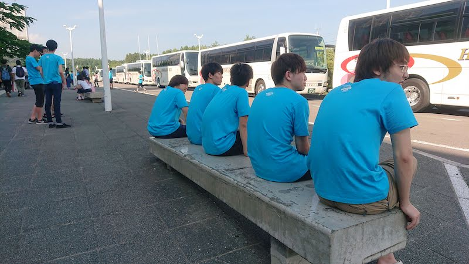

