

## 目次

- [研究室紹介出展概要](#研究室紹介出展概要)
- [システムソフトウェア研究](#システムソフトウェア研究)
- [研究紹介](#研究紹介)
- [研究活動](#研究活動)
- [問い合わせ先](#問い合わせ先)
- [おわりに](#おわりに)

## 研究室紹介出展概要

- オープンラボ当日は，対面にて，下記の催しを行います．
  - はこペパッと
  - k8scape
  - ひみつのエライザちゃん
  - シーソーゲーム 〜IaCなPiの桁〜

## システムソフトウェア研究

本研究室では，システムソフトウェアの研究をとおして，社会で**飛びぬけて活躍できる**エンジニアスキルを身につけることを目指しています．

### システムソフトウェアって何？

システムソフトウェアは，PC やスマホで動く様々なアプリケーションの快適な動作や安心・安全を支える**縁の下の力持ち的**なソフトウェアです．  
代表的なものとして，OS（オペレーティングシステム）があります．  
（例：Windows，Mac，Android，Linux など）

### システムソフトウェアがないとどうなるの？

例えばインターネット... OS がないと，複雑で難解なネットワーク通信を自分で制御しなければならず，ネットサーフィンするのも一苦労です．

例えば，アプリケーションを使うとき... Word や Excel，ゲームや Web ブラウザを同時に使えなかったり，フリーズしたり快適に動作しなかったりします．さらに，システム攻撃や情報漏えいに対して無防備になります．

### システムソフトウェアを研究して，いいことあるの？

#### いいことその１：**ブラックボックスの解明**

Windows や Mac，Android など，システム内の動作や仕組みを理解できるため，システムやアプリケーションのチューンナップ，エラー発生や動作不安定の原因究明に役立ちます．

#### いいことその 2：**最新技術研究とのコラボ**

IoT（Internet of Things）やビッグデータ，クラウドコンピューティングといった最新技術に触れることができます．

#### いいことその 3：**PC やスマホの眠れる力を呼び覚ます**

PC やスマホの性能を引き出し，新たな機能を創造できます．

### こんな人にオススメ

- コンピュータやプログラムが動いている裏側を知りたい！
- 低レイヤに関する技術力を高めたい！
- 松原克弥先生が好き！

#### キーワード

- システムソフトウェア技術（仮想化，ネットワーク，システムプログラミング，並列分散処理など）
- コンピューティング技術（クラウド，IoT など）
- 圧倒的成長
- 松原克弥

## 研究紹介

### セルフホスト型WebAssemblyランタイムを用いた基盤機能の実行時拡張

**中田 裕貴**  
博士 3 年

- WebAssembly（Wasm）：多様なプログラム言語のコンパイル対象となるバイトコードフォーマット
- ブラウザやデバイス、サーバ向けのWasmランタイム実装が複数あり、環境を問わず同じバイトコードを実行可能
- 一方、利用可能な拡張命令・機能はランタイムごとに異なり、実行可能なバイトコードに制約
- Wasmにコンパイルされたセルフホストランタイムに拡張命令・機能を実装し、それを介してバイトコードを実行
- セルフホストランタイムを実行するホストランタイムで実装済の命令・機能を利用して、未実装分をセルフホストランタイムで再現
- セルフホストに特化したランタイムを設計し、高速化手法を実装

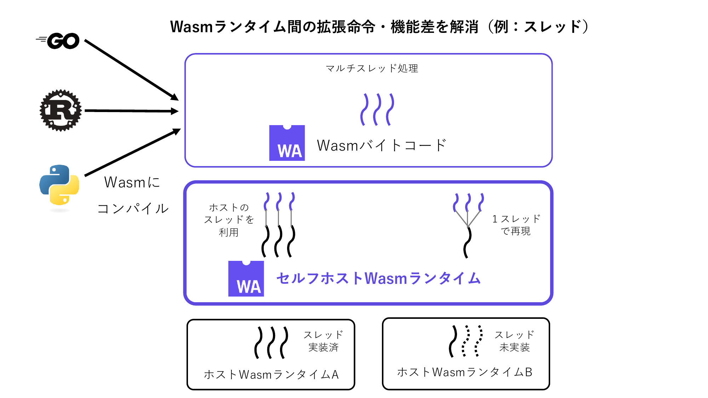

### 長時間稼働WebAssemblyプロセスを対象としたソフトウェア若化手法

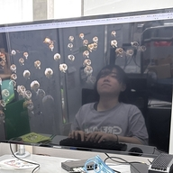

**中村 碧那**  
高度ICTコース・4年

- WebAssembly（Wasm）は、サンドボックス性やプラットフォーム非依存性を活かして、Webブラウザだけでなくエッジ・サーバ・データベースなど長時間稼働する用途へ適用範囲が拡大している
- 長時間稼働するWasmプロセスでは、ランタイム内部状態やアプリのメモリ構造である線形メモリ上の状態が蓄積し、メモリ使用量の増加や性能劣化につながるソフトウェアエイジングを考慮する必要がある
- ソフトウェアエイジングに対する若返り手法（ソフトウェア若化）では、プロセスをキルし、再生成することにより、ランタイムやアプリ両方に存在する性能劣化につながるような要因の除去が図れる
- 本手法では、再生成時に、チェックポイント・リストア（C/R）を行うことにより、線形メモリの状態を引き継ぎつつ、若返りが可能である
- 加えて、リストア時にオンデマンドによる線形メモリの復元を行うことで、アクセスされた領域のみの復元が可能となる

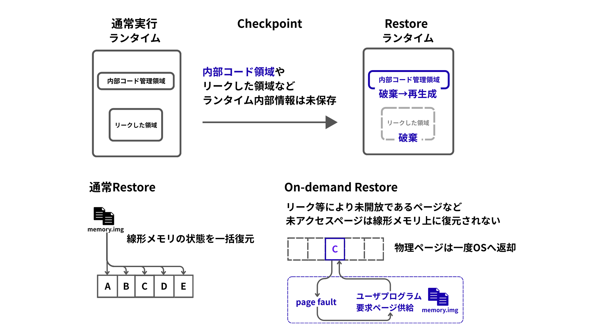

### ロボット機能モジュールを対象としたアーキテクチャ中立な動的マイグレーション機構

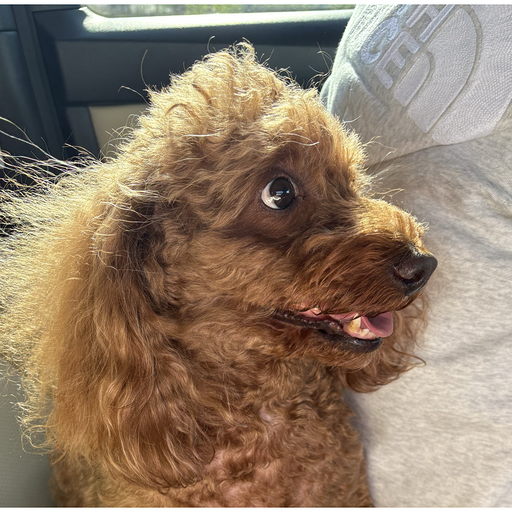

**梶村 拓斗**  
高度ICT領域・修士1年

- クラウドコンピューティングの発展によりロボットの処理をクラウドとロボットで分担するクラウドロボティクスが普及
- Robot Operating System(ROS)は、センサ値取得や地図生成などの各機能モジュールをノードとして実装し、ネットワークを介して分散配置することが可能で、クラウドロボティクスにも応用される
- 現状のROSではロボットの移動などの環境変化に応じて、実行状態を維持したままノードを別のデバイスへ移動できる仕組みがない
- 本研究では異なるデバイス間でROSノードを動的にマイグレーションする機構を提案
- ロボットとクラウドではCPUアーキテクチャが異なる場合があり、実行状態に互換性がないという課題に対して、WebAssemblyを用いることで対処
- 環境変化に合わせた柔軟なROSノードの配置を実現

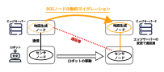

### 機密計算とリアルタイム処理を両立するAIoT向けシステム基盤技術

**藤井 大悟**  
博士 1年

- クラウドでは、システム管理者やOSを完全に信頼できない環境でも、機密情報を安全に処理できることが求められている
- こうした要求に対し、管理者やOSからもデータやプログラムを保護できる機密計算が注目されている
- 一方、機密性を保証するための一部の保護処理は、OSより高い権限で中断されずに実行されるため、他のアプリケーションの応答遅延を招き、リアルタイム処理ではデッドラインミスを引き起こす可能性がある
- この問題を回避するためにCPUコアを分離すると、アプリケーション間で計算資源を柔軟に共有できず、資源の利用効率が低下する
- 本研究では、機密性を維持しながらCPUを柔軟に管理するため、保護処理を安全に中断・再開する仕組みの設計を目指す

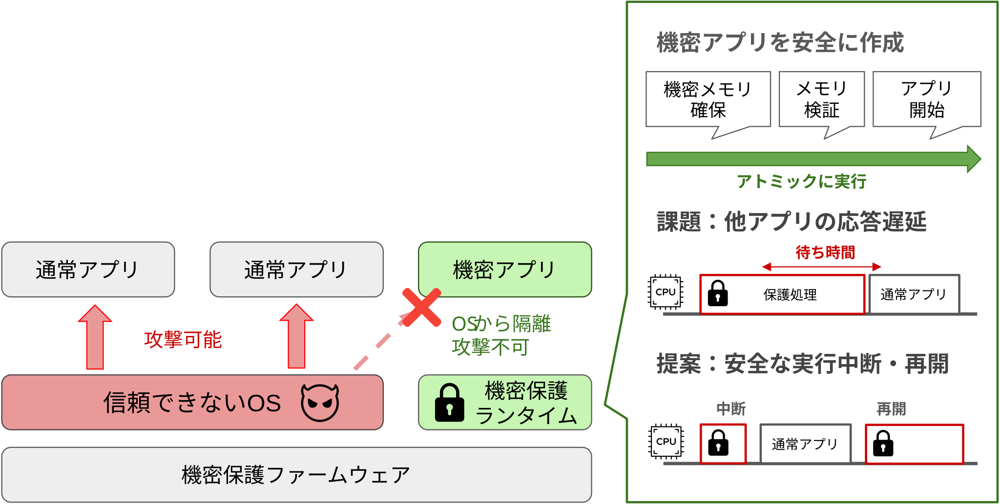

### 異種OS機能連携によるセキュアコンテナを対象とした安全なシステムコール代理実行機構

**坂本 光太郎**  
高度ICT領域・修士1年

- マイクロサービス・アーキテクチャなどのクラウドネイティブなシステム構築の普及にともなって、クラウド基盤におけるコンテナ型仮想化技術が広く普及
- Linuxコンテナはコンテナ間でLinuxカーネルを共有するため、カーネル脆弱性を悪用した攻撃への対処が必要
- 先行研究では、Linux以外のOS上でLinuxコンテナを互換実行することで、Linuxカーネル脆弱性に対する攻撃を低オーバヘッドに回避可能
- 本研究では、制限されたシステムコールを安全に代理実行することで、アプリケーションの動作を維持しながらコンテナの安全性を向上
- また、先行研究で実装されているコンテナの実行環境とネットワーク機構を連携させ、コンテナとして実行・管理できる環境構築が必要

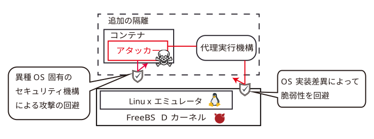

### 検索可能暗号データを対象としたクライアント透過型ベクトル抽出機構

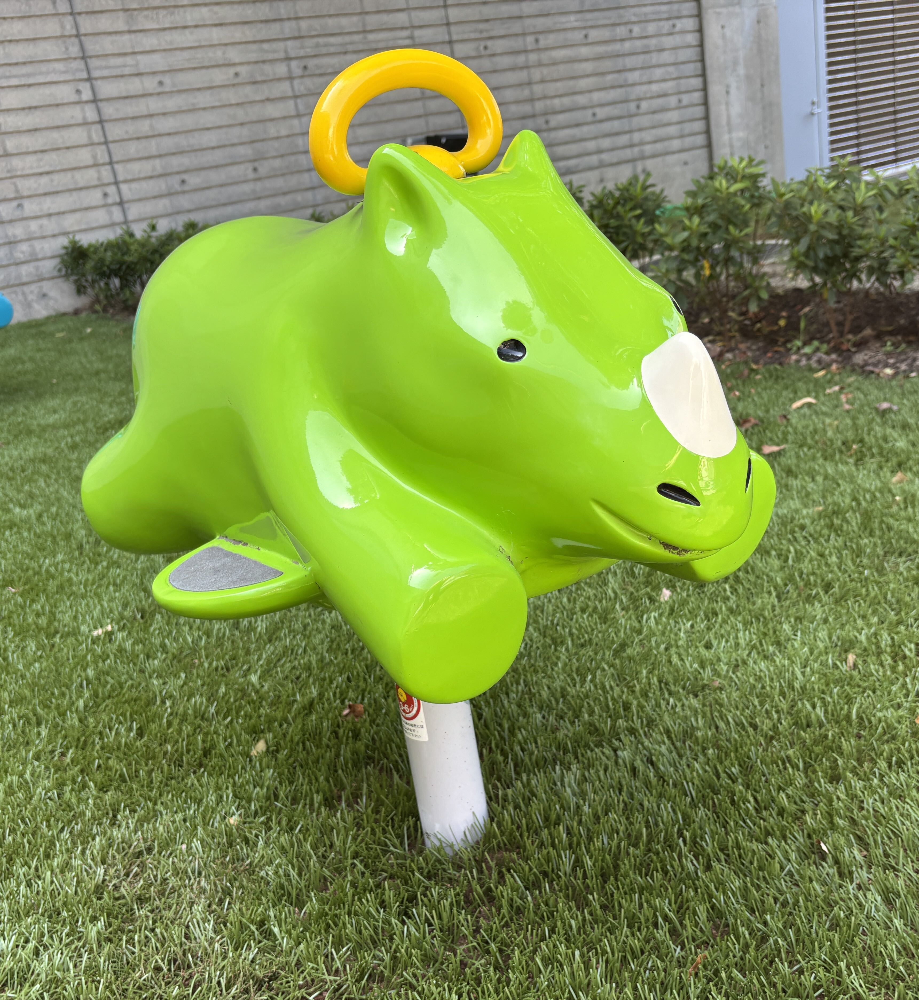

**村松 良祐**  
高度ICTコース・4年

- RAG（検索拡張生成）をはじめとする生成AI活用の普及にともなって、データベースにおけるベクトル検索の利用が拡大
- MongoDBのAutomated Embeddingは、データの挿入・更新を検出してサーバー側で自動的にベクトルを生成するため、クライアント側の煩雑なベクトル生成処理を不要化可能
- 一方、機密データを保護するため、クライアント側で暗号化したまま検索可能な検索可能暗号（Queryable Encryption）の活用が進展
- しかし、検索可能暗号を有効にするとサーバー側には暗号文しか届かないため、Automated Embeddingによるベクトル生成が不可能となり、両機能を同時に有効化できないという課題が存在
- 両機能を併用するにはクライアント側でベクトルを生成する必要があり、クライアントの改造や更新検出処理の実装などの負担が増大
- 本研究では、Automated Embeddingの呼び出し先である外部埋め込みサービスをTEE内の代替サーバーに置き換え、TEE内で復号とベクトル生成を行うことで、クライアントを改造することなく検索可能暗号とAutomated Embeddingの共存を実現

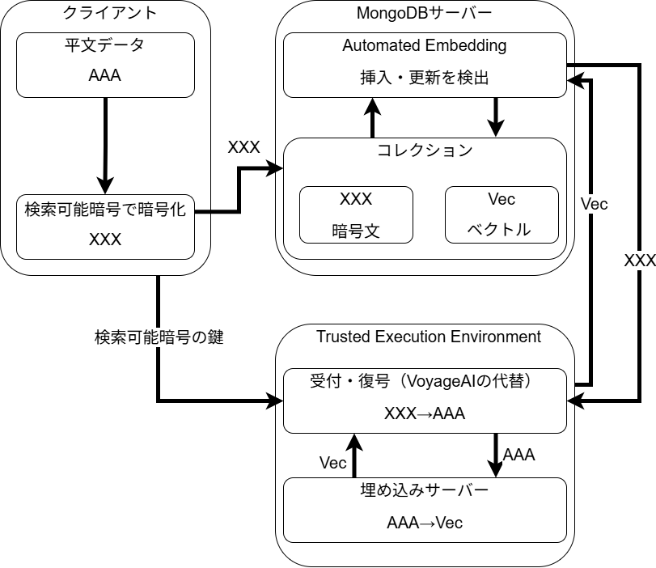

### 広域分散AIoTクラスタを対象としたP2P型モデル配信機構

**森田 理央**  
高度ICTコース・4年

- 生成AIの普及にともない、大規模言語モデル（LLM）をエッジデバイスなどの手元の端末で動かす利用が拡大
- 一方、LLMのモデルファイルは数GB〜数十GBと巨大で、利用前に全体のダウンロードと保存が必要なため、記憶容量や通信帯域の限られた端末には大きな負担
- Mixture-of-Experts（MoE）型のLLMは、内部を多数のエキスパートに分け、入力ごとに一部のエキスパートだけを使って計算するため、1回の計算に使うのはモデルの一部のみ
- 本研究では、モデルをエキスパート単位に分割してP2Pで共有し、推論中に必要になったエキスパートだけを他の端末から取り寄せる機構を提案
- 推論エンジンからは通常のモデルファイルとして見えるため、既存の推論エンジンをほぼそのまま利用可能
- 本研究では、取り寄せたエキスパートを端末どうしで配り合うことで、各端末のダウンロード量と記憶容量の削減を目指す

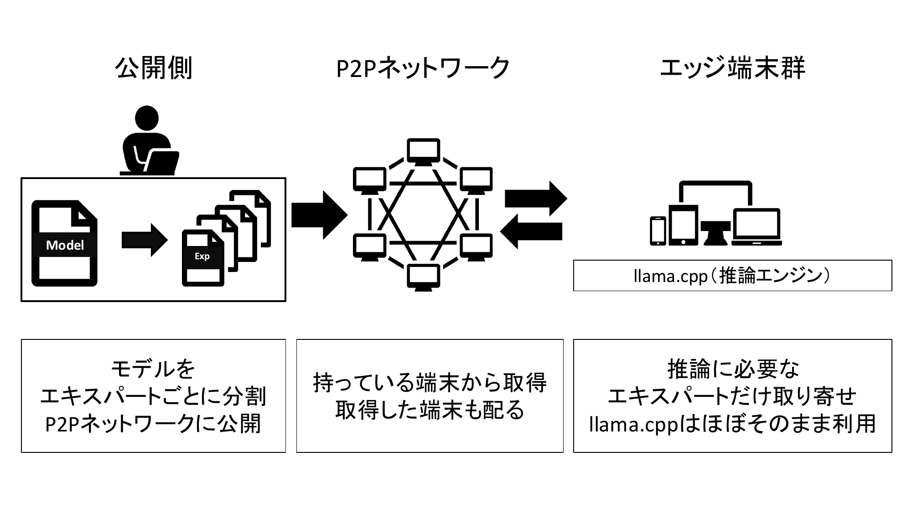

### オフロード型クラウド自動構成における耐障害性向上のための制御アーキテクチャ

**遠山 楓**  
情報システムコース・4年

- プログラミング演習環境を手動で構築する場合、複雑で時間がかかるなど教員側の負担が増加
- インフラの構築や設定をコードで記述し、自動で環境を構築できるIaC(Infrastructure as Code)の利用が有効
- IaCを利用した先行システムは、エラー中断時に構築状況を把握できず、再実行時に環境が重複するなどの問題が存在
- そのため、先行システムには、複数回実行しても環境が同じになる性質である冪等性が欠如
- 本研究では、クラウド上に演習環境が作成された際、その状態を記述したファイルをユーザー側に共有して状態を確定させることで、冪等性を実現

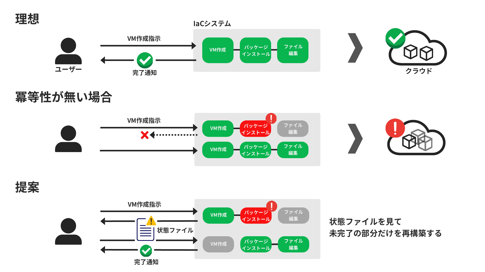

### 遠景・夜景に対するカメラ姿勢推定の絶対アライメント手法

**生田 立樹**  
情報システムコース・4年

- 函館山展望台からスマホをかざすと、景色に建物名や地名が重なって表示されるAR鳥瞰案内の実現を目指す
- スマホの電子コンパスは周囲の磁気の影響で方角が大きくずれることがあり、名前が実際とは違う場所に表示されてしまう
- 既存手法として、カメラ画像から向きを求めるVPS（Visual Positioning System）もあるが、室内や街中など近くの景色が前提で、遠景や夜景には向いていない
- 本研究では、昼でも夜でもスマホの方角を補正する手法の開発に取り組む
- 手法のひとつとして、函館山ならではの景色である「海岸線」に注目し、カメラ画像から機械学習で空・海・陸を識別して地図の海岸線と照合する方法を検討

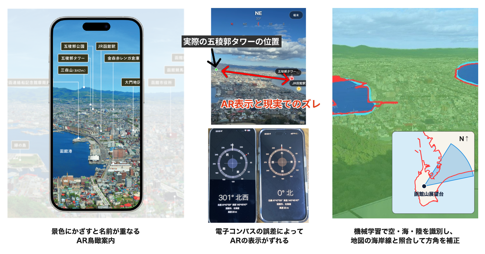

[**過去の卒業研究・修士研究（発表論文へのリンク）**](https://researchmap.jp/ktymtbr/published_papers)

[**研究室サイト（学会発表実績など）**](https://oss-fun.github.io/)

## 研究活動

### 設備

研究室では，学部 4 年生が利用する表部屋と，院生が利用する院生室と裏部屋の 3 つが提供されています．

研究室には，高級キーボードや大型ディスプレイ，ドローンやロボットなどのデバイス，PC クラスタやサーバ PC など，こだわりの研究設備が揃っています．

研究室内のメンバーだけでなく，楽しい後輩たちや他の研究室のメンバーともコミュニケーションを取りながら，楽しく研究できます．

### ゼミ

本研究室では，教員と学生の予定に合わせて，進捗報告のゼミを週2回行っています．

### 学会

研究やゼミを通して順調に成果を出すことで，学会やオープンソース系の会議（RubyKaigi，OSC，Open Source Summit など）に参加することができます．

研究が上手くいけば，海外に行けるかも！？

### イベント

本研究室では，研究以外にもメンバー内での交流を図るために，新歓，BBQ，飲みなどのイベントを開催しています．もちろん，お酒が苦手な人でも気軽に参加できるような雰囲気で楽しんでいます！

研究室内外に関わらず，本研究室に興味がある人も参加できるかも...？

## 問い合わせ先

## おわりに

当研究室にきて，圧倒的成長しよう！ 
低レイヤ沼が君を待っている！

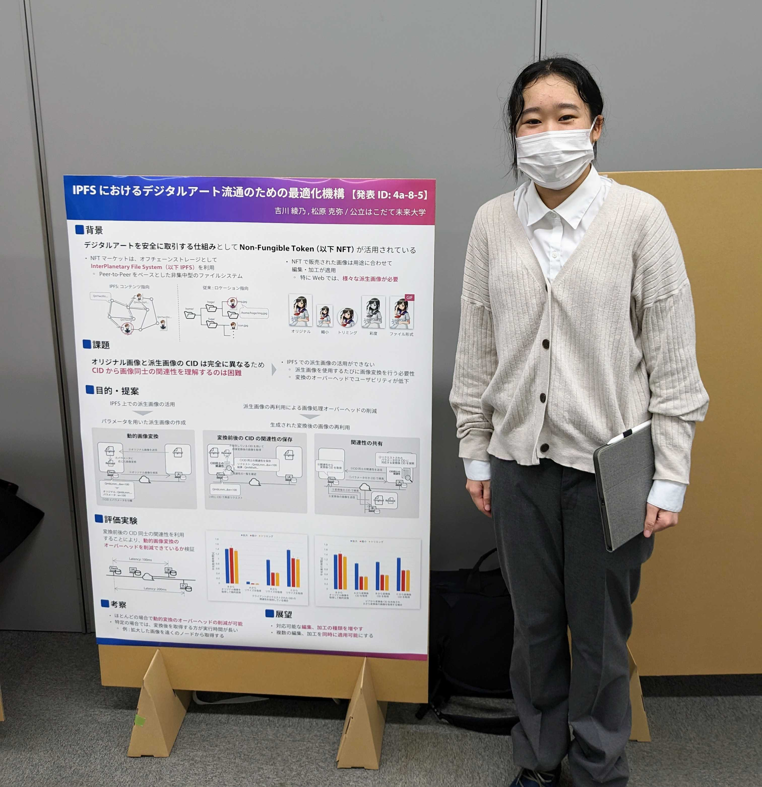

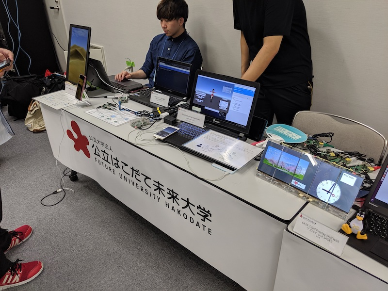

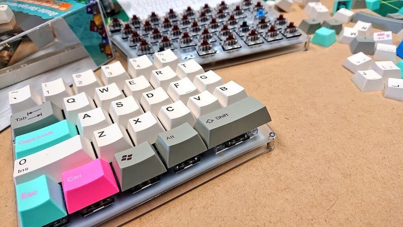

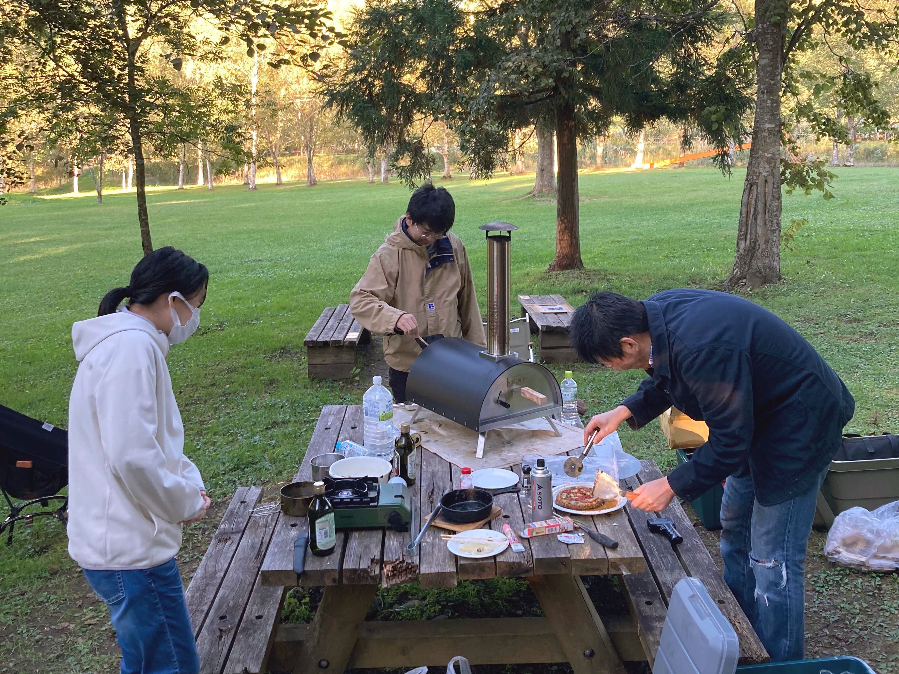
